# Hamiltonian World Models for Reinforcement Learning and Control

Research question: when does Hamiltonian structure improve control across energy regimes, after accounting for coordinate representations, second-order priors and data coverage?

**Final research release complete.** The English academic manuscript, source, protocols, numerical evidence, scientific figures and actual simulation animations are included. Phase 8 independently checks coverage on a coupled Duffing system, correctly recentered odd-force models and action-hold refinement. Phase 7's candidate remains stopped after failing every frozen gate. The contribution is original empirical research and analytical synthesis, not a new successful learning algorithm or a guaranteed publication.

**Start here:** [Paper PDF](paper/Hamiltonian_Control_Study.pdf) · [Output index](ARTIFACT_INDEX.md) · [Offline showcase](docs/demo.html) · [Reproducibility](docs/REPRODUCIBILITY.md) · [Contribution boundaries](docs/CONTRIBUTIONS.md)

**Author:** Jiajun Fu, Duke Kunshan University.

## See the system in motion

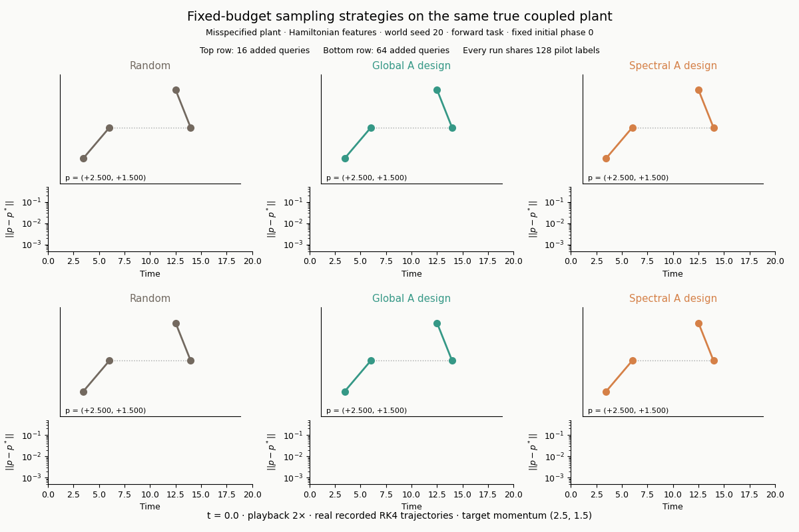

*Recorded RK4 trajectories of the same true coupled plant. Columns compare random, global A and spectral A acquisition; rows use 16 or 64 added labels. The parallel rods depict angular coordinates and coupling. This is an illustrative fixed test phase; aggregate outcomes are reported in the paper.*

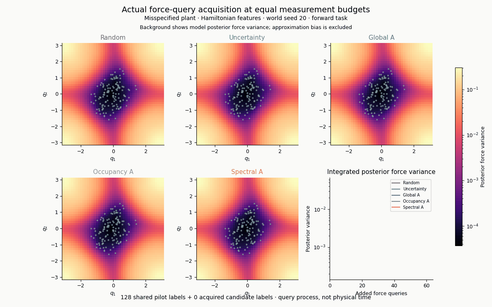

*Actual query sequence and posterior force variance at equal measurement budgets. Grey points are the shared local pilot, cyan rings are selected configurations and stars mark the latest query. Frame index counts queries, not physical time. Posterior variance excludes model bias.*

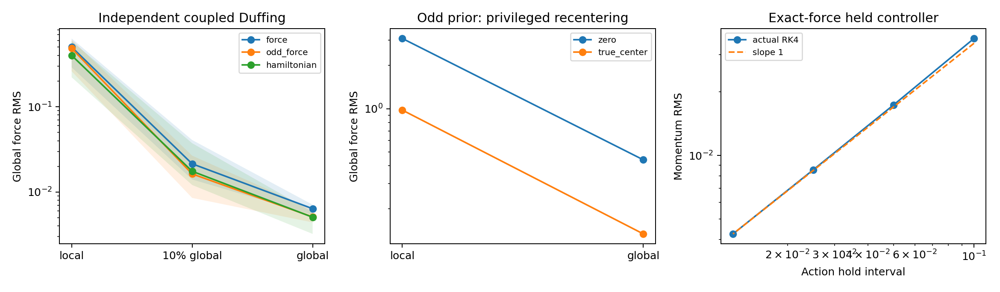

*Independent coupled Duffing validation, correctly recentered symmetry prior and exact-force action-hold refinement. These plots distinguish data coverage, representation and control discretization.*

## Repository contents

This repository includes all research-stage source, synthetic datasets and fitted checkpoints (losslessly bundled under `artifacts/`), raw experiment records, failed pilots, the 18-page paper and editable sources, and PNG/SVG/GIF visuals. Start with the paper or open `docs/demo.html` locally for the offline showcase. The existing MIT license is preserved. Run `python restore_artifacts.py` after cloning to restore all original dataset/checkpoint paths.


## Reproduce

```bash
python restore_artifacts.py
python -m pip install -r requirements.txt
python run_phase1.py
python run_phase2.py
python verify_phase2.py
python identifiability_example.py
python animate_phase2.py
python -m pip install -r requirements-rl.txt
python verify_phase3.py
python run_phase3.py --calibrated --workers 4
python reassess_phase3.py
python plot_phase3.py
python animate_phase3.py
python run_phase4.py --workers 4
python run_rotation_probe.py --workers 4
python run_work_loops.py
python plot_phase4.py
python animate_work_loops.py
python animate_phase4_rotation.py
# Phase 5 can be reproduced independently after installing dependencies.
python run_phase5_models.py
python verify_phase5.py
python run_phase5_control.py --workers 4
python phase5_sensitivity.py
python run_phase5_tracking.py
python plot_phase5.py
python phase5_diagnostic_figures.py
python animate_phase5.py
python verify_phase5_results.py
# Phase 6 also runs independently after installing dependencies.
python run_phase6_models.py
python verify_phase6.py
python run_phase6_prediction.py --workers 4
python run_phase6_controllers.py --workers 2
python run_phase6_sac.py --workers 4
python phase6_noise_audit.py
python plot_phase6.py
python animate_phase6.py
python verify_phase6_results.py
# Phase 7 runs independently after installing dependencies.
python verify_phase7_design.py
python run_phase7_acquisition.py --workers 4
python run_phase7_control.py --workers 4
python run_phase7_model_metrics.py
python phase7_decision.py
python phase7_symmetry_check.py # explicitly posthoc invariant-design check
python plot_phase7.py
python animate_phase7.py
python verify_phase7_results.py
# Final bounded validation
python run_phase8.py
python verify_phase8.py
```

This recreates numerical checks, datasets, fitted checkpoints, CSV/JSON diagnostics, PNG/SVG figures and actual-rollout GIFs. Set OPENBLAS_NUM_THREADS=1 for CPU efficiency. Phase 3 takes several minutes and may take longer on slower hardware. Use --workers 1 if memory is limited. Existing complete Phase 3 run records are reused; remove the desired run's JSON and checkpoint to rerun it. Detailed reports accompany each stage. The optional original exploratory pilot can be regenerated with `python run_phase3.py --workers 4`.

## Single-pendulum simulator (Phases 1–4)

`simulator.py` implements canonical state `(q,p)`, unwrapped angle, RK4 and separable velocity Verlet, with accumulated signed work as an auxiliary variable. `PendulumEnv` has reset/step methods and five-element step returns, but is deliberately a minimal environment, not a Gymnasium subclass. A later adapter will supply spaces and integration with an RL library.

Observation: `[cos(q),sin(q),p]`. Actions: torque in `[-2,2]`. Control interval: 0.05; five RK4 substeps. Episode: 400 intervals / 20 normalized time units. The provisional integrated reward is minus the upright cost `1+cos(q)+0.1*p²+0.01*u²`. The upright reward and success definitions were frozen for the Phase 3 comparisons. Energy diagnostics in info are for validation, not policy inputs.

## Phase 5 in brief

Both plants have known unit mass and unit torque ports; the second includes a true harmonic outside the fitted Fourier basis. Models use noisy low-energy force snapshots. Primary learned-model SAC runs use zero additional true transitions and three crossed world/policy seeds. Exact gradient-force and Hamiltonian feature-head fits are equivalent under the same objective. World-model optima are checked, while finite-budget SAC still limits task performance. Fixed feedback and ridge sensitivity expose that distinction.

The main Phase 5 protocol was frozen before fitting and control outcomes. Two diagnostic protocols were frozen later and are explicitly posthoc. Neither diagnostic selects new main models. All checkpoints are final checkpoints. Scripts resume completed policy records with matching protocol/model fingerprints.

## Phase 6 in brief

Six force families share Fourier bandwidth and known kinetic/torque structure. Training and validation sample counts are fixed while global configuration fractions are 0%, about 10% and 100%. Models are selected on independent noisy validation labels before fresh tests. Correct Hamiltonian structure helps local extrapolation in this benchmark, while coverage narrows that advantage. An incorrectly centered odd prior has an explicit approximation floor. Feedback/MPC improve far more than finite-budget SAC; all 36 SAC training speed resets are retained.

`phase6_protocol.json` freezes the primary experiment; `phase6_noise_audit_protocol.json` explicitly marks a later explanatory audit. The shifted plant is a coordinate-origin probe, not an independent physics replication. The experiment assumes synthetic force queries; physical acquisition cost is not modeled. No claim of general deep-HNN superiority or a new regression theorem is made.

## Preview


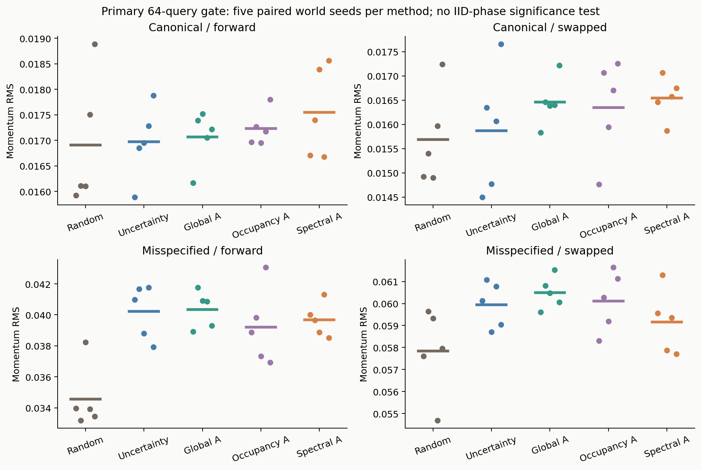

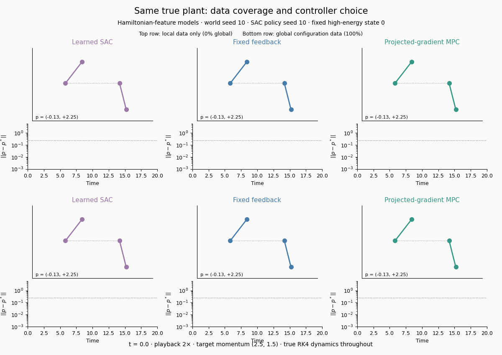

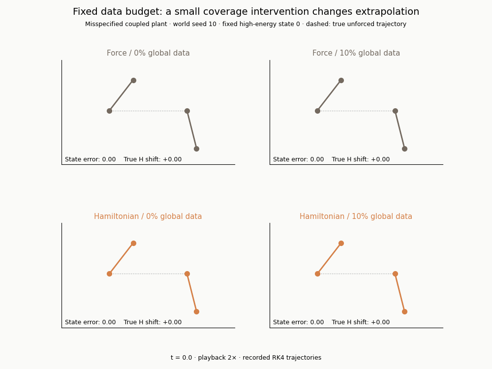

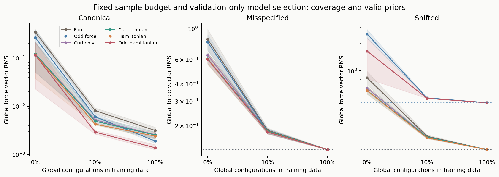

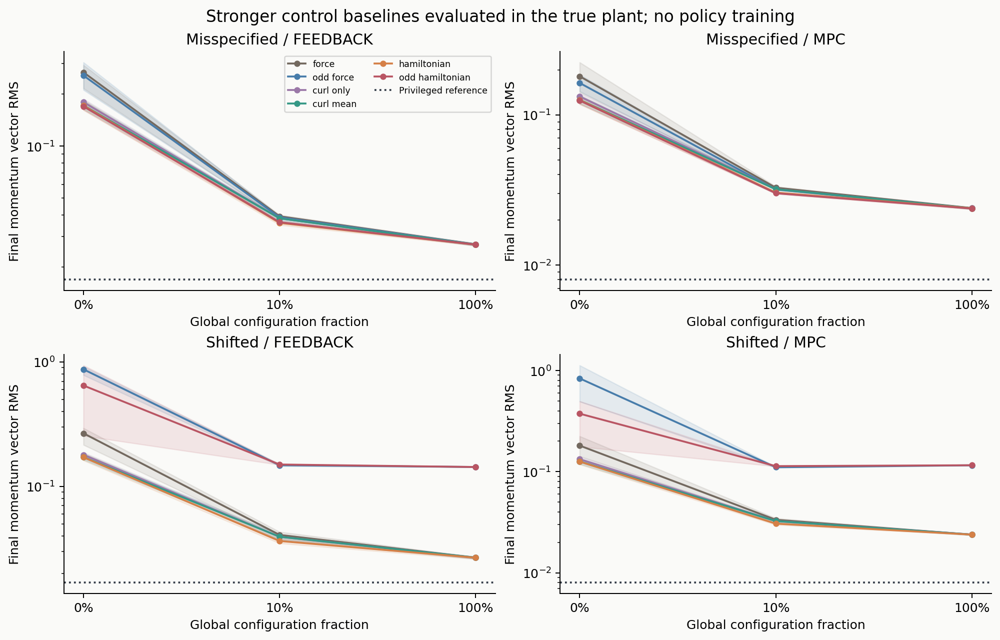

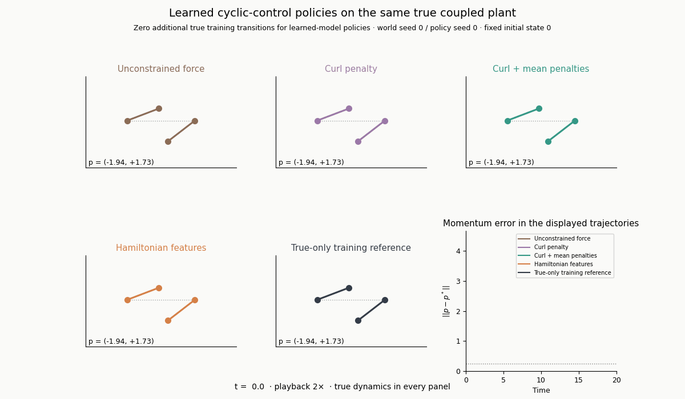

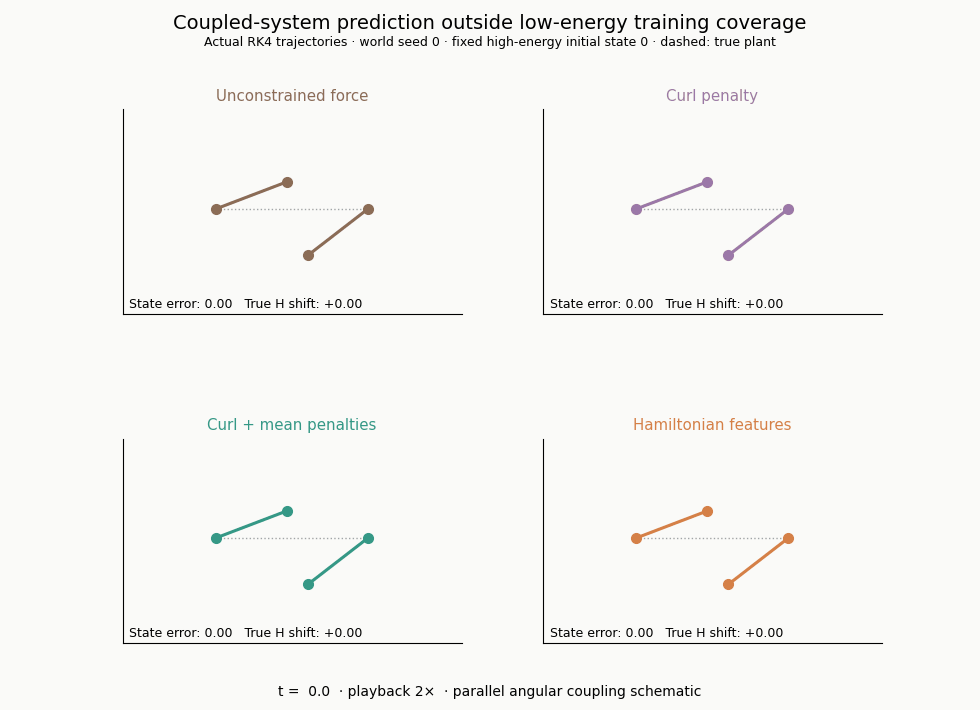

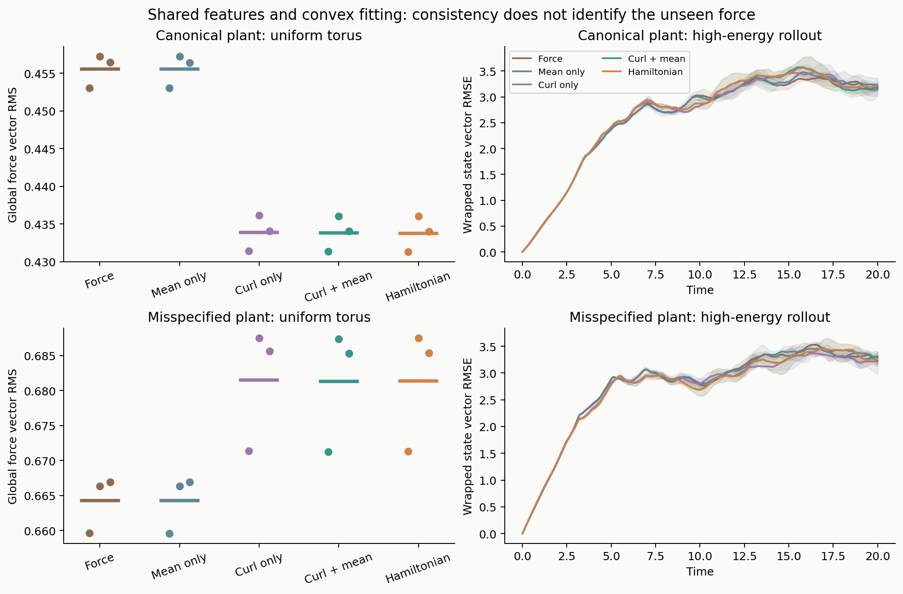

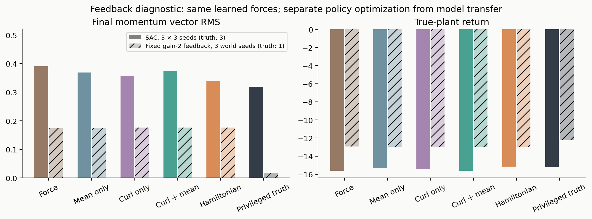

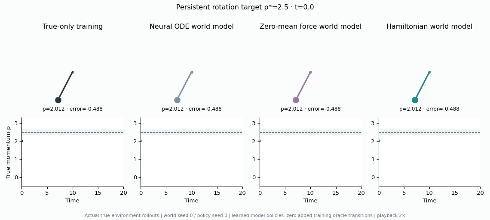

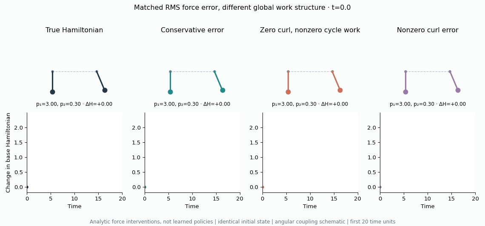

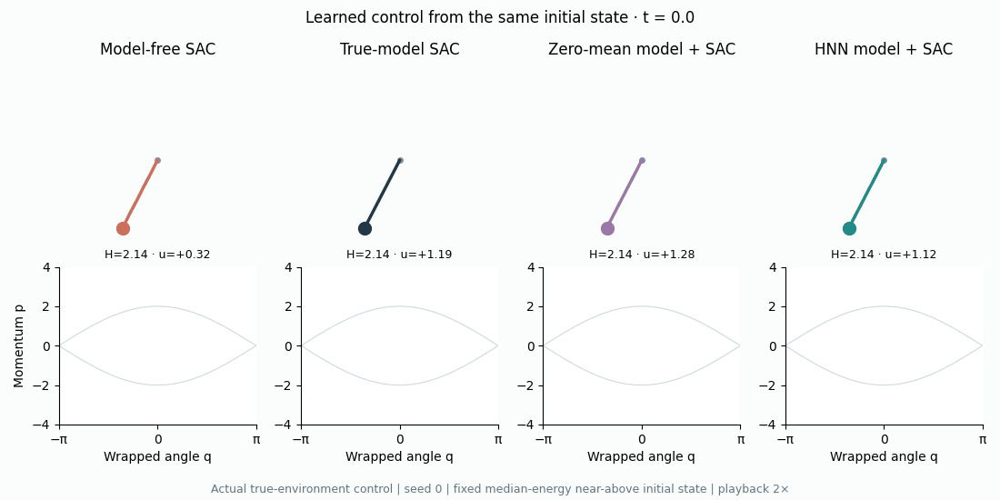

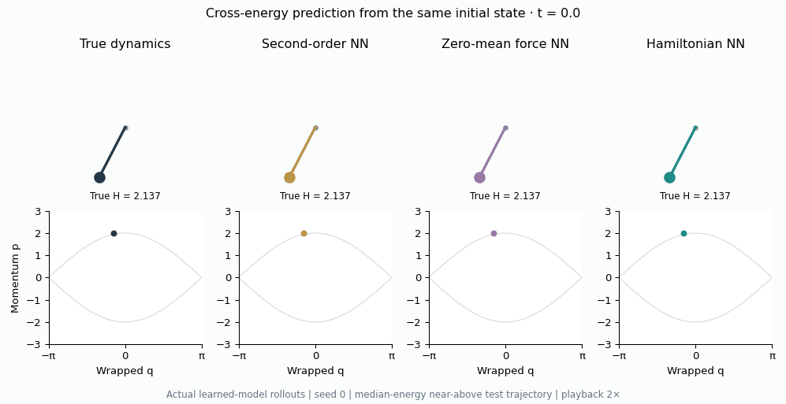

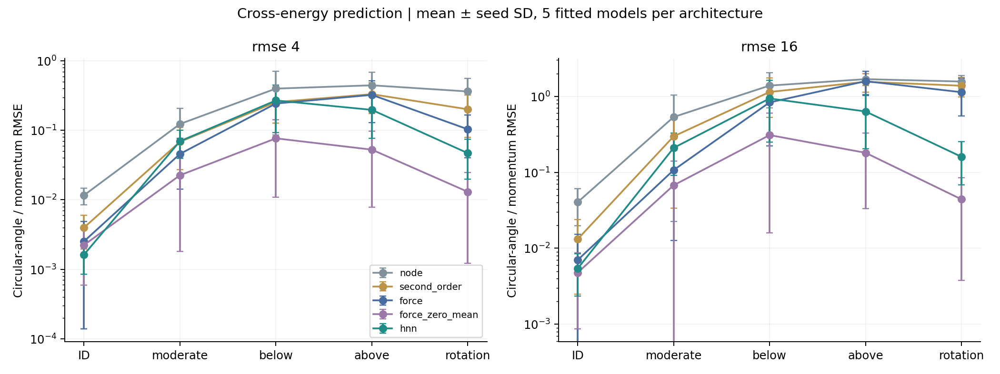

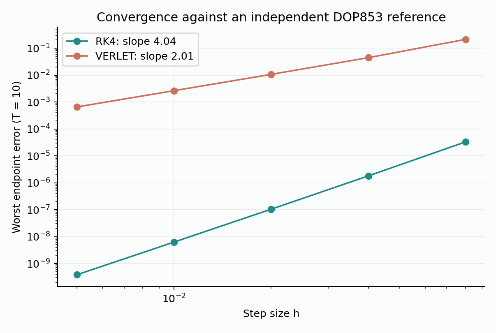

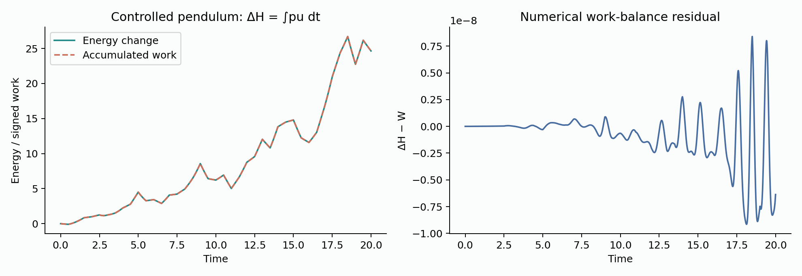

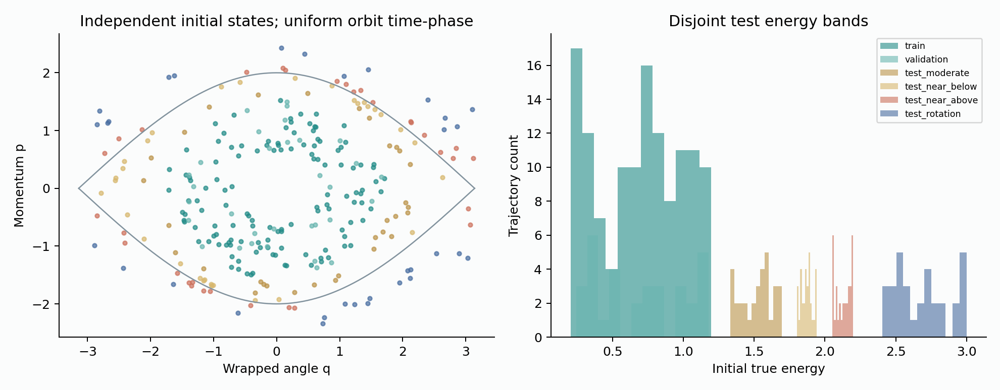

## Single-pendulum data (Phases 1–4)

Six `.npz` splits contain states `[trajectory,time,2]`, held-constant actions `[trajectory,transition]`, unique trajectory IDs, initial energy, time-phase and dt. Each trajectory has 201 states / 200 transitions at dt=0.02. Training has 128 trajectories; validation and each of four test bands have 32. Total 288 trajectories and 57,600 transitions; only 25,600 transitions belong to training.

These are synthetic, uncontrolled prediction data, generated from the stated exact equations. They are not external observations or controlled RL replay. Split at trajectory level. Fit normalization using training only. Do not tune on held-out test bands. Initial energy is sampled uniformly within each stated interval and phase uniformly in time over an orbit period; this is not uniform sampling over phase-space area.

## Release status

The complete computational research release is included in this repository. The failed acquisition candidate and unsuccessful optimization pilots remain part of the record. The contribution is an original empirical comparison and analytical synthesis; absolute bibliographic priority and publication acceptance are not established. Author: Jiajun Fu, Duke Kunshan University.
