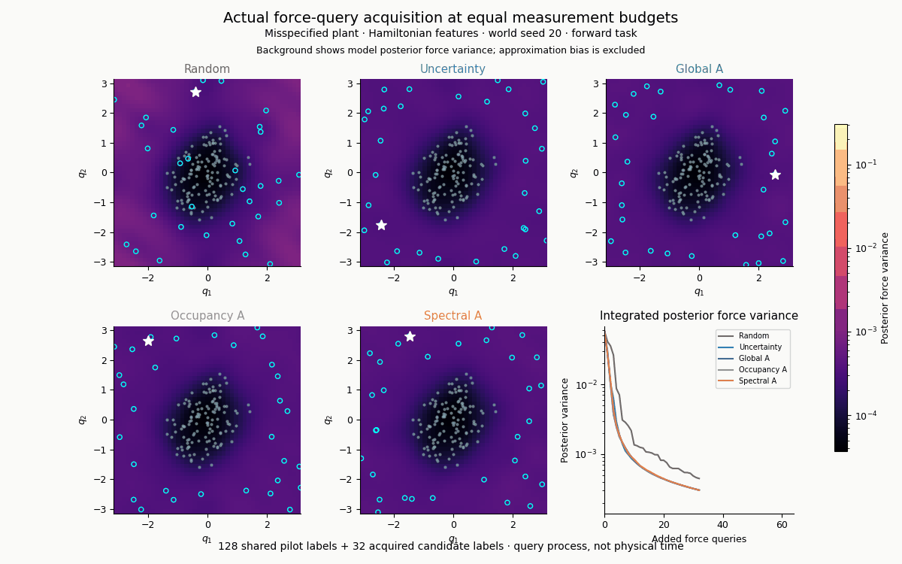

# Abstract {.unnumbered}

Hamiltonian structure is a useful inductive bias, but its contribution to downstream control can be obscured by known mechanics, coordinates, data coverage and policy optimization. We present a reproducible study that separates these factors using controlled pendulum systems, exact Fourier force regressors, neural world models, finite-budget soft actor-critic (SAC), fixed feedback and model predictive control. The central contribution is an experimental decomposition of apparent structure advantages, with independently checked mathematical diagnostics and a retained negative acquisition result. In a validation-selected coupled-pendulum benchmark, Hamiltonian force estimation improves local extrapolation, while global coverage substantially narrows the gap. An incorrectly centered parity prior has an explicit approximation floor, removed by privileged recentering. Independent coupled Duffing validation reproduces the dominant coverage effect. A frozen task-weighted acquisition candidate fails all four primary tracking cells despite reducing its posterior uncertainty criterion. Finally, exact-force control exhibits first-order action-hold error, separating a numerical controller floor from model uncertainty. These findings support conditional, task-specific interpretations of structure rather than a universal Hamiltonian advantage. The study supplies original computational results and a self-contained analytical synthesis; it does not introduce a new general learning algorithm or assert novelty of classical regression, filtering or invariant-design results.

**Keywords:** Hamiltonian learning; model-based reinforcement learning; experimental design; data coverage; coordinate priors; sampled control.

# Introduction

A dynamics model can conserve its own learned energy and still predict the wrong physical trajectory. A more accurate dynamics model can also fail to improve a learned policy when optimization is the limiting factor. Both distinctions matter when Hamiltonian world models are used for reinforcement learning.

Our question is: **when does Hamiltonian structure improve cross-energy prediction and control after accounting for coordinate representations, mechanical priors, coverage, regularization and optimization?** We investigate the question through staged, paired interventions. The initial single-pendulum experiments motivate the stronger multidimensional comparisons, rather than supply a stand-alone claim of algorithmic superiority. The main analysis uses finite-dimensional force spaces whose regression objectives can be solved and verified directly. This makes it possible to distinguish model fitting from policy optimization.

The study contributes three linked pieces of original experimental evidence. First, a coverage and coordinate-origin benchmark compares equal-dimensional parity and Hamiltonian subspaces, supplemented by a correctly recentered parity diagnostic. Second, a predeclared acquisition screen demonstrates a gap between a task-weighted covariance objective and actual held-action tracking. Third, an independent quartic-system validation and action-hold refinement check test the main alternative explanations. Classical mathematical identities connect these experiments; they are attributed as background rather than promoted as new theorems.

This is an original research manuscript reporting newly executed simulations and analyses. It is not a certificate that no similar empirical observation has appeared previously, and it is not a claim that the failed candidate is a novel successful algorithm. The manuscript is suitable as a reproducible research report and a basis for scholarly review. Submission, venue fit and acceptance require independent assessment.

# Related work and scope of originality

Hamiltonian neural networks parameterize a scalar energy and obtain the vector field through canonical differentiation [1]. Controlled Hamiltonian learning has also been developed in Symplectic ODE-Net [2]. These works motivate the structural model families; our convex feature experiments do not replicate their full architectures.

Gruver et al. already analyze second-order modeling and coordinate complexity as explanations of Hamiltonian-network performance [3]. Accordingly, deconstructing physical priors is not a new general agenda. Our contribution is the particular coverage intervention, coordinate-origin comparison, controlled optimization separation and unsuccessful acquisition record, together with independently reproducible diagnostics. Claims about the source of performance are confined to the systems and model classes tested here.

Hamiltonian and odd-symmetry kernel/random-feature models are established approaches [4]. Our Fourier heads are transparent finite-dimensional comparators, not exact implementations of that published kernel algorithm. Task-optimal exploration in linear and nonlinear dynamics already uses task-dependent estimation metrics [5,6]. Bayesian active reinforcement learning [7] and transition-occupancy matching [8] address additional policy-relevant information. The spectral acquisition used here specializes weighted experimental design to periodic tracking; neither its weighted trace nor Gaussian covariance update is new. We do not compare against full implementations of those algorithms and cannot claim to outperform them.

Invariant-design symmetrization is classical [9,10]. The torus specialization below explains why frequency weighting alone need not favor nonuniform query locations. It is explanatory analysis added after the frozen gate, with assumptions that intentionally exclude the actual fixed local pilot.

# Systems, representations and information access

## Controlled mechanics

We study separable systems with known unit kinetic energy and torque ports,

$$H(q,p)=\frac12\|p\|^2+V(q),\qquad \dot q=p,\quad \dot p=F(q)+u,\quad F=-\nabla V.$$

Every multidimensional comparator knows these kinematics and input channels. Thus the measured structural effect concerns the force representation, not discovery of unknown inertia or canonical coordinates. With control, the true energy balance is $\dot H=p^\top u$. Energy diagnostics use signed work and do not imply energy conservation during actuation.

The periodic potential is

$$\begin{aligned}
V_s(q)={}&1-\cos(q_1-s_1)+0.8[1-\cos(q_2-s_2)]\\
&+0.3[1-\cos(q_1-q_2-s_1+s_2)]\\
&+\varepsilon[1-\cos(3(q_1-s_1)-(q_2-s_2))].
\end{aligned}$$

Canonical, misspecified and shifted conditions use $(\varepsilon,s)=(0,0)$, $(0.06,0)$ and $(0.06,(0.45,-0.35))$. The shifted condition is a coordinate-origin probe of the same physics, not independent physical replication.

The independent validation uses a coupled Duffing potential on $\mathbb R^2$,

$$V_D(x,y)=0.5x^2+0.65y^2+0.1(x-y)^2+0.25x^4+0.2y^4.$$

This changes domain and functional family; its validation concerns force estimation only. No Duffing SAC or control-transfer result is claimed.

## Force spaces

The periodic force expansion uses twelve representatives,

$$\mathcal K=\{(a,b):a=1,2,\ b=-2,\ldots,2\}\cup\{(0,1),(0,2)\},$$

$$F(q)=c+\sum_{k\in\mathcal K}[A_k\cos(k^\top q)+B_k\sin(k^\top q)].$$

Unrestricted force has 50 coefficients. Odd force sets $c=A_k=0$ and has 24. Hamiltonian force has zero mean and coefficients parallel to $k$, also with 24. Odd Hamiltonian force has 12. Equal parameter count removes one confound; it does not make the two 24-dimensional spaces identical in geometry or expressivity. Soft mean/curl penalties retain 50 coefficients, with statistical effective degrees of freedom depending on regularization.

The Duffing comparison uses all force monomials of degree at most three (20 coefficients), odd-degree force monomials (12), or gradients of nonconstant potentials of degree at most four (14). Dimensions are explicitly different. No Duffing result is presented as a parameter-matched structure comparison.

## Budgets and split discipline

The main coverage experiment uses 4,096 training and 1,024 independent validation force pairs per condition, three world seeds and local/global coverage fractions 0, approximately 0.1 and 1. Sample counts are fixed. Ridge and soft penalties are chosen by validation force error before fresh test evaluation. There are 162 selected models from 1,620 candidates. Selection is not based on policy return.

The final diagnostic protocol is separately frozen before its outcomes, after the earlier results are known. It uses five fresh seeds, 512 Duffing labels per coverage condition, noise standard deviation 0.03 and fixed ridge $10^{-6}$. Local configurations lie in $[-0.35,0.35]^2$ and global/test configurations in $[-1.5,1.5]^2$. A shared 4,096-point test estimates global force RMS. Prefix replacement and shared noise pair coverage conditions. This diagnostic tests a specified explanation rather than supplies an independent preregistration of the whole study.

Generative force queries are synthetic. Reachability, sensor cost, contacts and unknown input dynamics are not modeled. Zero additional truth queries during model-only policy training must not be confused with zero world-model pretraining labels.

# Analytical decomposition

## Learned energy and identifiable physics

Antisymmetry gives $\nabla\widehat H^\top J\nabla\widehat H=0$: exact Hamiltonian flow conserves its own energy. This places no quantitative bound on conservation of the true $H$ without a relation between $H$ and $\widehat H$. A smooth potential perturbation supported outside observed configurations can leave all local force labels unchanged and alter unseen dynamics. Structural consistency therefore does not identify the unobserved potential. These are classical facts, illustrated here by explicit work and missing-mode experiments.

On a torus, curl-free force additionally requires zero cycle periods to be a gradient of a periodic potential. A constant force bias has zero curl but nonzero cycle work. Our earlier exact-error intervention holds global force RMS at 0.04 across three error types: conservative perturbations produce bounded true-energy error in the stated construction, while a constant bias produces substantial secular work. This is an analytic intervention, not evidence that learned models necessarily exhibit those exact errors.

## Coordinates and approximation floors

Translation rotates each sine/cosine coefficient pair. Full Fourier and Hamiltonian spaces are translation-closed; sine-only odd spaces generally are not. The omitted harmonic $k_*=(3,-1)$ gives the exact squared force approximation floor

$$\inf_{\widehat F}\|\widehat F-F\|_{L^2(\mathbb T^2)}^2=\frac{\varepsilon^2\|k_*\|^2}{2}=5\varepsilon^2.$$

For $\varepsilon=0.06$, the RMS floor is 0.134164. Oddness about an incorrect origin adds

$$\frac12\sum_{j\in\{1,2,d\}}a_j^2\|k_j\|^2\sin^2(k_j^\top s)$$

to that squared floor, giving approximately 0.4435 for the stated shift. Known-center recentering removes the added parity term. It does not identify an unknown symmetry center for free and does not remove the missing mode.

## Conditional estimation variance

Let $v=T\theta$ encode a structural subspace, $D$ the empirical feature Gram matrix and $R$ the population force-norm metric. For a fixed design and fixed quadratic regularizer, write $A_T=T^\top(D+\lambda R+Q)T$. Independent componentwise noise variance $\sigma^2$ gives

$$\operatorname{Cov}(\widehat\theta\mid q)=\frac{\sigma^2}{N}A_T^{-1}D_TA_T^{-1},\qquad D_T=T^\top DT,$$

$$\mathcal V=\frac{\sigma^2}{N}\operatorname{tr}(R_TA_T^{-1}D_TA_T^{-1}).$$

After population whitening without soft penalties, this becomes

$$\mathcal V=\frac{\sigma^2}{N}\sum_j\frac{d_j}{(d_j+\lambda)^2}.$$

Local coverage can create small design eigenvalues and large noise amplification. A valid restricted subspace changes both dimension and restricted spectrum; broad coverage raises poorly observed directions. This is a variance identity, not total risk, a bound on extrapolation bias or the unconditional risk of validation-selected ridge. A separate 2,000-perturbation audit verifies the fixed-ridge calculation without changing selected models.

## Periodic tracking and acquisition

For continuous unsaturated feedback $u=-F_0(q)-\kappa(p-p_*)$, a small force perturbation $\delta F$ induces first-order error

$$\dot e_1+\kappa e_1=\delta F(q_0+p_*t).$$

For mode frequency $\omega_k=k^\top p_*$, uniform-phase steady response has squared contribution

$$\frac{\|A_k\|^2+\|B_k\|^2}{2(\kappa^2+\omega_k^2)}.$$

This is a standard stable-filter calculation, local in perturbation amplitude and time. It is not a guarantee for actuator saturation, finite-horizon phase drift, full policy return or optimal RL.

Force-whitened features $B(q)$ use scalar prior precision $\rho=0.05$ and noise variance $\sigma^2$. With $A=\rho I+\sum B_i^\top B_i$, posterior covariance is $\Sigma=\sigma^2A^{-1}$. Task design minimizes $\operatorname{tr}(W\Sigma)$; Woodbury gives the exact rank-two covariance gain. This covariance excludes misspecification bias.

**Proposition (classical invariant-design specialization).** Suppose the force space is translation-closed, $W$ commutes with its orthogonal translation representation, and the only fixed information is scalar $\rho I$. For approximate design $\xi$, $M(\xi)=\int B^\top B\,d\xi$, Haar-uniform design minimizes $\operatorname{tr}[W(\rho I+nM)^{-1}]$.

**Proof.** Translation maps $M$ to $O_s^\top M O_s$ without changing the criterion. Haar-averaging the translated design gives uniform configuration measure and, by force whitening, information $I$. Convexity of inverse weighted trace and Jensen's inequality yield $\Psi(I)\le\int\Psi(O_s^\top MO_s)\,ds=\Psi(M)$. This establishes optimality, not uniqueness. The actual nonuniform pilot violates the assumption; finite random sampling is not identical to approximate uniform design. The sine-only class also lacks translation closure. $\square$

## Sample-and-hold error with an exact force model

A true-force controller can have nonzero error because actions are held. The following consistency statement specializes ordinary sampled-control analysis, rather than proposing a new control theorem.

**Proposition (finite-horizon first-order action-hold response).** Assume $F$ is $C^2$ with bounded derivatives on a neighborhood of the finite-horizon trajectories, no saturation, $p(0)=p_*$ and exact continuous integration between control updates. At times $t_n=nh$, hold $u_n=-F(q_n)-\kappa(p_n-p_*)$. As $h\to0$, uniformly at grid times on fixed $[0,T]$,

$$p_n-p_*=h\eta(t_n)+O(h^2),\qquad \dot\eta=-\kappa\eta+\frac12DF(q_0+p_*t)p_*,\quad\eta(0)=0.$$

**Proof.** Taylor expansion of the exact held-input flow gives $e_{n+1}=(1-\kappa h)e_n+\frac12h^2DF(q_n)(p_*+e_n)+O(h^3)$, with uniform remainder on the stated neighborhood. A discrete Gronwall estimate gives $e_n=O(h)$ and $q_n=q_0+p_*t_n+O(h)$. Substitution and division by $h$ show that $e_n/h$ obeys forward Euler for the displayed linear ODE with local defect $O(h^2)$. Finite-horizon first-order convergence gives $e_n/h=\eta(t_n)+O(h)$, proving the result. The statement is not uniform in arbitrarily long time and excludes clipping. $\square$

This explains an $O(h)$ error scale without claiming that every Phase 7 discrepancy has this cause. The final refinement diagnostic uses the actual unsaturated held controller and a much smaller RK4 integration substep. It is distinct from the clipped primary experiment.

# Experiments and results

## Coverage and coordinate intervention

For the canonical periodic plant, mean global force RMS changes from 0.344 for unrestricted force and 0.117 for Hamiltonian force under local coverage to 0.0032 and 0.0024 under global coverage. On the misspecified plant, corresponding local values are approximately 0.838 and 0.604, while global values approach the common 0.134 approximation floor. Thus valid structural restrictions help local estimation in this experiment, but do not identify the missing harmonic.

The final recentering diagnostic uses five fresh seeds and fixed ridge, not the earlier validation-selected fits. Under global coverage, the zero-centered odd force has mean RMS 0.44018; the privileged correctly centered model has 0.13399, near the common floor. Local values are 3.08673 and 0.97780. The large local errors show that recentering alone does not solve extrapolation. These results support a coordinate-dependent prior explanation, not an intrinsic inferiority of correctly centered parity.

{width=95%}

## Control and RL optimization

The coupled benchmark includes 220 actual feedback/MPC configurations and 57 new SAC training runs. SAC uses final checkpoints, 16,000 transitions and 7,492 updates per run, with three world and three policy seeds in the selected comparisons. All 36 speed-reset interventions are retained. A reset changes the training distribution and is a limitation, not an invisible implementation detail.

Hamiltonian MPC mean momentum RMS improves from approximately 0.1258 under local coverage to 0.0304 with mixed coverage and 0.0239 globally. Unrestricted-force MPC changes from 0.181 to 0.0328 and 0.0240. Under global unshifted coverage all six force families achieve 100% strict success for both tested controller types. The corresponding SAC comparison remains substantially worse: global momentum RMS is approximately 0.422 for force, 0.373 for odd force and 0.370 for Hamiltonian models, against 0.264 for the privileged true-model SAC reference. The Hamiltonian/odd gap is small relative to the controller optimization gap.

These results distinguish performance of a fitted model from performance of a finite-budget optimizer. They do not prove SAC asymptotic failure or a universal superiority of feedback/MPC. The known-force references are privileged and are not theoretical lower bounds for every finite sampled controller.

{width=95%}

## Frozen acquisition screen

The acquisition study starts with 128 noisy low-energy labels and adds 16, 64 or 256 selected labels from an unlabelled 1,024-configuration pool. It compares random sampling, pointwise uncertainty, global A-design, frozen-occupancy A-design and spectral task A-design. Five paired world seeds, two plant conditions, three force spaces and two target momenta produce 660 unique fitted models. There are 964 actual control evaluations; pilot aliases increase reported rows to 1,200 and are not additional replications. Across paths, 53,760 added-query calls use 8,001 distinct shared plant/world/pool-index label keys, plus 1,280 unique pilot labels.

The clipped controller runs for 20 time units at held interval 0.05. Sixty-four fresh uniform configuration phases start exactly at target momentum. The primary metric is momentum-vector RMS over the final five time units. This is tracking, not swing-up. The frozen practical gate requires at least 10% improvement over the best of four baselines and at least four of five paired-seed wins in every Hamiltonian B=64 cell, plus bounded degradation at other budgets.

| Plant/task | Best baseline RMS | Spectral RMS | Degradation | Seed wins |
|:--|--:|--:|--:|--:|
| canonical, forward | 0.016906 | 0.017547 | 3.79% | 2/5 |
| canonical, swapped | 0.015687 | 0.016543 | 5.46% | 1/5 |
| misspec., forward | 0.034552 | 0.039674 | 14.83% | 0/5 |
| misspec., swapped | 0.057841 | 0.059162 | 2.28% | 2/5 |

The candidate fails every primary cell. Random is the best mean baseline in those cells, established after comparing all four baselines. The gate is descriptive, not a significance test, and 64 phases do not create 64 independent fitted-world seeds. The new-algorithm route is stopped; no rescue variants, additional candidate tuning or conditional MPC confirmations are introduced.

In the misspecified forward task, spectral acquisition reduces posterior tracking standard deviation from random's 0.00470 to 0.00411, but increases actual RMS from 0.03455 to 0.03967. The uncertainty criterion excludes omitted-mode bias. This observed divergence is stronger evidence against the candidate's practical promise than a favorable covariance-only plot would be evidence for it.

{width=95%}

## Independent validation and hold refinement

Coupled Duffing validation produces 45 fits. Mean global force RMS is:

| Coverage | Force (20) | Odd force (12) | Hamiltonian (14) |
|:--|--:|--:|--:|
| local | 0.50148 | 0.48487 | 0.40054 |
| 10% global | 0.02146 | 0.01634 | 0.01755 |
| global | 0.00639 | 0.00511 | 0.00507 |

Coverage dominates the between-class difference; odd force slightly improves on the Hamiltonian mean under mixed coverage. This is independent-domain support for the coverage interpretation, with explicit dimension and fixed-ridge limitations. It is not another acquisition experiment.

The exact-force unsaturated action-hold diagnostic uses 32 shared phases over ten time units and evaluates the final five. Hold intervals 0.1, 0.05, 0.025 and 0.0125 give momentum RMS 0.035818, 0.017367, 0.008557 and 0.004248. The fitted log-log slope is 1.025. The observed refinement supports a first-order hold floor in that diagnostic, consistent with the finite-horizon expansion. It does not quantify every source of error in the clipped primary test.

{width=100%}

## Simulation storyboards and interpretation

Figures below are extracted from the archived numerical animations, not generated illustrations. The same recorded case is used across every frame: misspecified periodic plant, Hamiltonian force head, world seed 20 and forward target. The control storyboard additionally fixes held-out initial phase zero and B=64. Its six panels show one trajectory under two acquisition rules at three times; they are not six independent experiments. The rods depict angular coordinates with separate pivots and an indicated coupling, not the geometry of a serial double pendulum.

{width=100%}

{width=100%}

{width=100%}

The corresponding GIFs are `phase7/phase7_control_comparison.gif` and `phase7/phase7_acquisition.gif`. They play in the repository README and offline demo; the PDF supplies static multi-frame summaries. Extraction indices, crop bounds and source hashes are recorded in `paper/figures/animation_stills_provenance.json`.

# Reproducibility and verification

The repository contains frozen protocols, raw JSON/CSV records, actual fitted checkpoints, code, PNG/SVG figures and real trajectory GIFs. Primary outcomes and posthoc diagnostics are labelled separately. Earlier failed optimization pilots remain available. No trained checkpoint is represented as an independently validated universal policy.

Regression normal equations, independent constrained-force fits, finite-difference controller gradients, Fourier Parseval identities and label-query audits check different failure modes. The final Duffing force/gradient check has maximum error $9.48\times10^{-11}$; an independent augmented-QR solution matches a Hamiltonian normal-equation fit within $2.10\times10^{-15}$. The largest final normal-equation residual is $4.18\times10^{-15}$. Acquisition verification checks selected labels only, confirms unique indices and protocol fingerprints, and reproduces the unchanged failed gate.

Full reproduction and a short demonstration are separated. The complete archive preserves all previous stages; a lightweight GitHub-ready bundle supplies source, protocols, figures, paper and numerical summaries without bulky replay/checkpoints. `ARTIFACT_INDEX.md` maps every output to its role. The final release records local validation and does not claim a remote GitHub publication or a DOI.

# Discussion and limitations

The strongest supported conclusion is conditional: structural force restrictions can reduce local estimation variance, but coverage, coordinate correctness and controller optimization can dominate practical rankings. Hamiltonian consistency and conserved learned energy provide useful diagnostics, not identification guarantees. A task-aware posterior criterion can also be an inadequate proxy for tracking under approximation bias and sampled control.

There are important limits. Both periodic plants share mechanics; the translated probe is not a new physical environment. Duffing validation is estimation-only and uses a correctly specified polynomial potential. All observations are synthetic, all multidimensional comparators know mass and ports, and no contact-rich or dissipative robotic plant is tested. Trainable deep-feature models are not exhaustively compared; the strongest main results concern exact finite-dimensional force heads. Five acquisition seeds support a descriptive screen, not broad statistical generalization. We do not provide full BARL, DYNAMICOED or published kernel-method replications. The prior literature review is scoped and cannot certify absolute absence of prior art.

The action-hold analysis deliberately uses an unsaturated reference to isolate consistency. The main clipped controller can exhibit saturation and larger-model-error effects. Likewise, posterior covariance excludes approximation bias, and the fixed-ridge noise calculation excludes hyperparameter-selection randomness. These distinctions prevent overinterpreting the analytical identities.

The manuscript's originality lies in its executed, inspectable comparison and the specific combination of interventions and negative results. Its mathematics provides a rigorous synthesis of established tools plus project-specific consistency calculations. A novel general algorithm, a new general optimal-design theorem and general HNN superiority are not contributions of this work. Independent review may judge the empirical contribution appropriate for a workshop, reproducibility study or technical report rather than a main-conference methods paper.

# Conclusion

Within the tested settings, Hamiltonian structure helps most when the force class is valid and observations are local. Broad coverage reduces that advantage, wrong coordinate-dependent symmetry introduces a removable floor, and finite-budget RL optimization can obscure improved world models. The failed acquisition screen and action-hold refinement show why task-aware uncertainty reduction is insufficient by itself. The released evidence supports a reproducible conditional account of Hamiltonian learning for control, with unsuccessful hypotheses retained as part of the research record.

\clearpage

# References {.unnumbered}

1. Greydanus, S., Dzamba, M., and Yosinski, J. (2019). *Hamiltonian Neural Networks*. NeurIPS. https://arxiv.org/abs/1906.01563
2. Zhong, Y. D., Dey, B., and Chakraborty, A. (2020). *Symplectic ODE-Net: Learning Hamiltonian Dynamics with Control*. ICLR. https://arxiv.org/abs/1909.12077
3. Gruver, N., Finzi, M., Stanton, S., and Wilson, A. G. (2022). *Deconstructing the Inductive Biases of Hamiltonian Neural Networks*. https://arxiv.org/abs/2202.04836
4. Smith, T., and Egeland, O. (2024). *Learning Hamiltonian dynamics with reproducing kernel Hilbert spaces and random features*. European Journal of Control, 80(B), 101128. https://doi.org/10.1016/j.ejcon.2024.101128
5. Wagenmaker, A., Simchowitz, M., and Jamieson, K. (2021). *Task-Optimal Exploration in Linear Dynamical Systems*. ICML, PMLR 139, 10641-10652. https://proceedings.mlr.press/v139/wagenmaker21a.html
6. Wagenmaker, A., Shi, G., and Jamieson, K. (2023). *Optimal Exploration for Model-Based RL in Nonlinear Systems*. NeurIPS. https://arxiv.org/abs/2306.09210
7. Mehta, V., Paria, B., Schneider, J., Ermon, S., and Neiswanger, W. (2022). *An Experimental Design Perspective on Model-Based Reinforcement Learning*. ICLR. https://arxiv.org/abs/2112.05244
8. Ma, Y. J., Sivakumar, K., Yan, J., Bastani, O., and Jayaraman, D. (2023). *Learning Policy-Aware Models for Model-Based Reinforcement Learning via Transition Occupancy Matching*. L4DC, PMLR 211. https://proceedings.mlr.press/v211/ma23a.html
9. Pukelsheim, F. (2006). *Optimal Design of Experiments*. SIAM, Classics in Applied Mathematics. https://epubs.siam.org/doi/book/10.1137/1.9780898719109
10. Idais, O., and Schwabe, R. (2021). *Equivariance and Invariance for Optimal Designs in Generalized Linear Models Exemplified by a Class of Gamma Models*. https://link.springer.com/article/10.1007/s42519-021-00221-z
