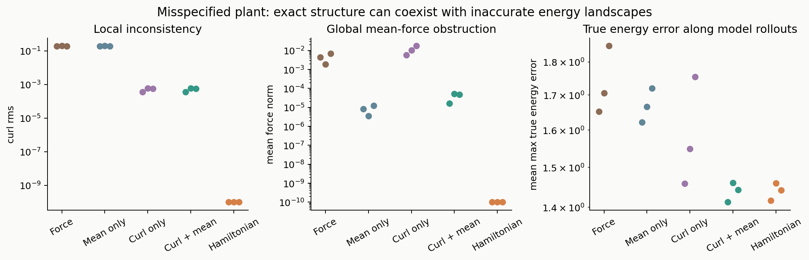
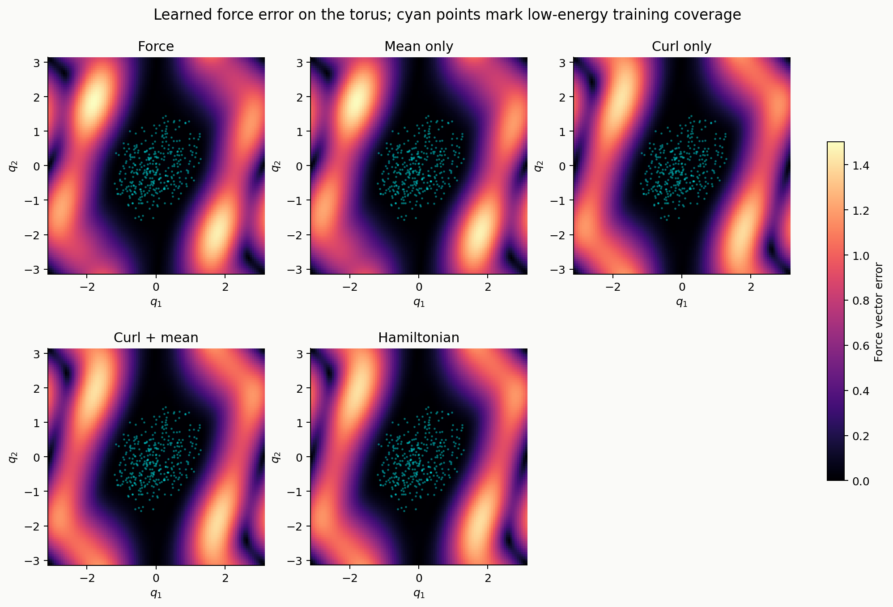
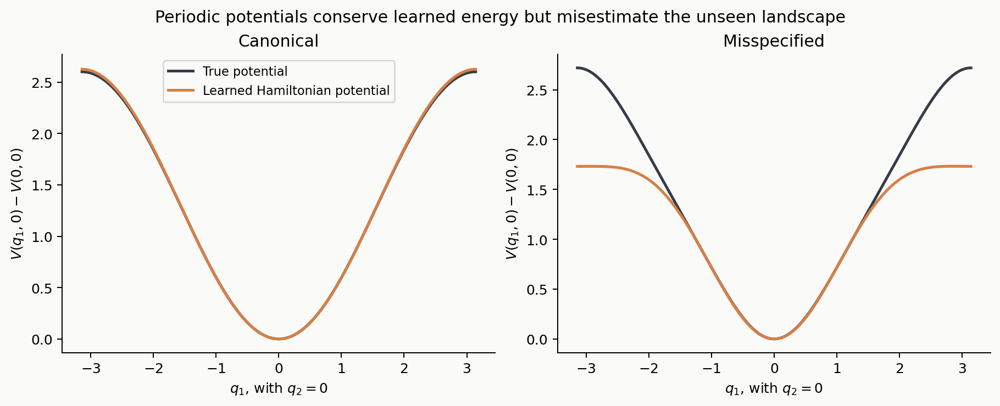
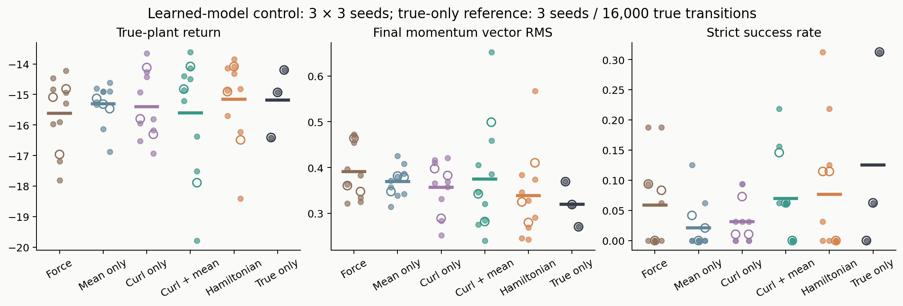
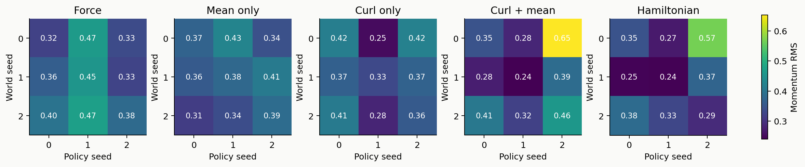
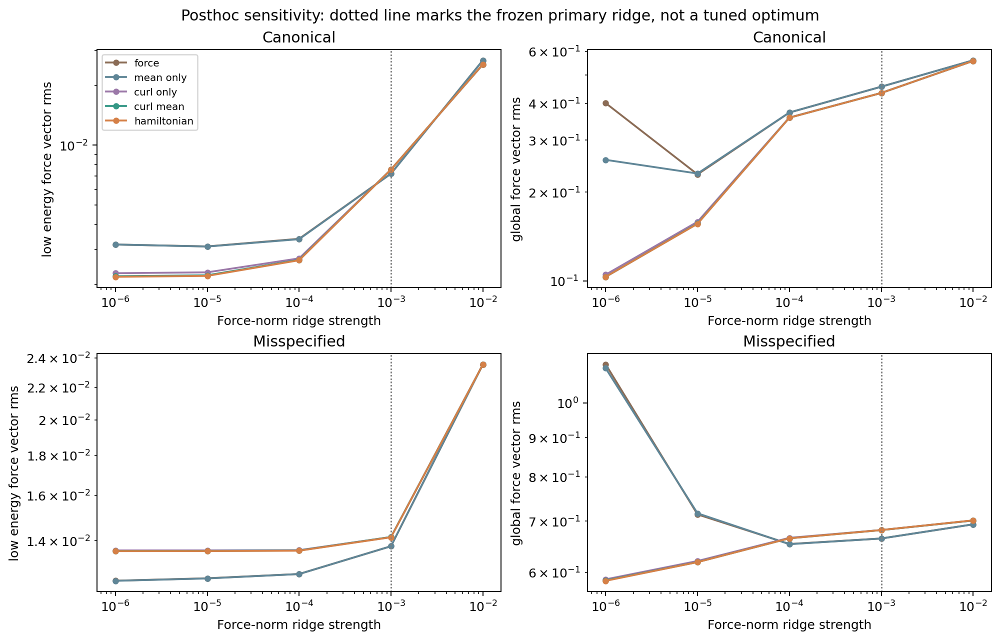

# Separating global force consistency from cross-energy prediction and cyclic control

**Phase 5 research report and working manuscript.** This report records a controlled feature-model benchmark. It does not establish a new learning method or submission-level originality.

## Abstract

Hamiltonian structure can constrain a learned vector field without identifying its true energy landscape or guaranteeing useful control. We study this distinction on coupled pendulums with configuration space a two-torus. Five model families share a finite periodic feature map and known unit kinetic energy and torque ports. Convex fitting separates mean-force and curl penalties from exact potential parameterization, removing nonconvex world-model optimization within this model class. Thirty primary world models cover a correctly specified plant and a deliberately misspecified Hamiltonian plant. Forty-eight SAC runs evaluate cyclic control in the latter, crossing three world seeds with three policy seeds and retaining three unique true-only references. Exact structural constraints suppress nonconservative components but do not uniformly improve unseen force accuracy. Control rankings vary by seed, and a fixed feedback diagnostic substantially outperforms the finite-budget SAC agents using the same learned forces. A posthoc regularization sweep further shows that apparent structural advantages depend on ridge strength. These results motivate control-relevant evaluation while limiting claims about general deep HNNs and algorithmic novelty.

## 1. Research question

The project asks **when Hamiltonian structure improves cross-energy prediction and control after accounting for representations, mechanical priors, data coverage and optimization**. Phase 4 supplied an analytic distinction between local curl consistency and global work consistency. Phase 5 tests actual learned coupled-system models. Its purpose is to isolate those constraints, not to assume that energy conservation determines a control ranking.

A torus matters because a constant force has zero curl but nonzero fundamental-cycle work. Conversely, an exactly conservative fitted force can preserve an incorrect periodic potential. Both effects must be separated from limited observations and policy learning.

## 2. Dynamics and data

The canonical plant has

\[
H_0(q,p)=\tfrac12\|p\|^2+1-\cos q_1+0.8(1-\cos q_2)+0.3(1-\cos(q_1-q_2)),
\quad \dot q=p,\quad \dot p=-\nabla V(q)+u.
\]

A second plant adds \(0.06[1-\cos(3q_1-q_2)]\) to its potential. It remains Hamiltonian; the added frequency lies outside the chosen feature space. Only this deliberately misspecified plant is used for the main control comparison. The canonical plant is an offline prediction comparison, not a second control replication.

Each plant and each of three fresh world seeds receives 4,096 independent state snapshots with true energy in [0.2,1.2]. Rejection sampling starts from uniform q in [-pi,pi]^2 and p in [-3.5,3.5]^2; it yields a uniform distribution on that bounded phase-space region conditional on the energy band, not uniform sampling in energy. Position-only force labels receive independent Gaussian noise of standard deviation 0.03 per component. Models for a given world seed share the same states and labels. Across plants and seeds there are **24,576 unique noisy force-labeled snapshots**. These are derivative observations, not trajectory transitions or controlled replay. Exact qdot=p and unit torque ports are known priors.

Independent paired test initial states are drawn in four bands: validation [0.2,1.2], moderate [1.3,2.0], mixed [2.2,3.2], and high energy [4.4,6.0], with 32 states per band. The last band is called `rotation` as an experimental label; in a coupled system this does not assert that every initial state lies on a pure rotating orbit or that there is one scalar separatrix threshold. Validation data do not tune the primary hyperparameters. Protocol energy computations define sampling and diagnostics; energy is not a policy observation.

## 3. Shared features and convex fitting

For 12 frequency representatives with component magnitudes at most two, the force model uses a constant plus 24 sine/cosine features. The force head has 50 free coefficients. Five families are fitted:

| Family | Curl constraint | Mean-force constraint | Effective free coefficients |
|---|---|---|---:|
| Force | None | None | 50 |
| Mean only | None | Soft penalty | 50 |
| Curl only | Soft penalty | None | 50 |
| Curl + mean | Soft penalty | Soft penalty | 50 |
| Hamiltonian features | Exact | Exact | 24 |

All families have the same spatial bandwidth and use the same data loss and **force-norm** ridge. They do not have equal effective capacity. The Hamiltonian model is a fixed Fourier-feature potential with a learned linear head, not a conventional deep HNN with trainable nonlinear features.

The primary objective is

\[
\frac1N\sum_i\|F(q_i)-y_i\|^2+0.001\|F\|_{L^2(\mathbb T^2)}^2
+\mu_c\|\operatorname{curl}F\|_2^2+\mu_m\|\overline F\|^2,
\]

with each active penalty equal to one. Exact Fourier orthogonality computes the structural penalties without collocation error. Positive ridge makes the quadratic objective strictly convex; direct normal-equation solves produce a unique optimum. The largest observed stationarity residual is 9.45e-16. An independent hard-constrained force solve agrees with the potential-head solution to 6.78e-14 in coefficients. This verifies the classical equivalence of their hypothesis classes and rules out a parameterization advantage in this specific convex setting. The mathematical note supplies derivations, dimensions and limitations.

For the omitted frequency, Fourier orthogonality gives an unavoidable uniform-torus force RMS floor of 0.06 sqrt(5), approximately 0.1342. Actual fitted errors can be much larger because the training configuration coverage is local and the labels are noisy.

## 4. Prediction and structural results

The following values average three world seeds. Global force RMS is the square root of the mean squared **vector norm** on a 128-by-128 torus grid. State error combines wrapped angle differences and momentum differences in the nondimensional simulation coordinates; it is not a physical unit-invariant metric.

| Family | Global force RMS, canonical | Global force RMS, misspecified | Misspecified curl RMS | Misspecified mean-force norm |
|---|---:|---:|---:|---:|
| Force | 0.4556 | 0.6643 | 0.1893 | 0.00438 |
| Mean only | 0.4556 | 0.6643 | 0.1896 | 0.00000815 |
| Curl only | 0.4339 | 0.6815 | 0.000502 | 0.01125 |
| Curl + mean | 0.4338 | 0.6813 | 0.000505 | 0.0000392 |
| Hamiltonian features | 0.4337 | 0.6814 | 0 | 0 |

Structure improves global force accuracy modestly in the canonical case at the frozen ridge. In the misspecified case at that same ridge, exact structure coexists with slightly larger force error than the unconstrained model. Neither result establishes a general ranking. Long-horizon high-energy state RMSE is approximately 3.2 across families, exposing substantial extrapolation failure.

The Hamiltonian models conserve their learned energy to at most 4.0e-9 in the saved high-energy rollouts. Their average maximum true-energy error in the misspecified case is nevertheless about 1.44. Learned energy conservation therefore does not imply true energy accuracy.

**Figure 1.** Lines average three world seeds and shaded bands show their range, not confidence intervals. Left-panel short bars show seed means. The canonical plant is correctly specified in spatial bandwidth; the second plant omits a true harmonic from the learned basis.

**Figure 2.** Three seed values per model. Exact zero quantities are displayed at a plotting floor of 1e-10 on the log axes. True energy is measured along fitted unforced trajectories, not true trajectories.

**Figure 3.** World seed 0, common color scale. Cyan points subsample training configurations. Error remains substantial away from the observed low-energy region despite exact periodic-potential structure.

**Figure 4.** A one-dimensional slice with q2=0, aligning potentials at the origin. The band is the range across three fitted Hamiltonian models. Conservation does not repair the fitted landscape outside support.

## 5. Crossed-seed cyclic SAC

The frozen main protocol trains toward momentum (2.5,1.5), with integrated cost \(\|p-p^*\|^2+0.01\|u\|^2\) and torque bounds of two per coordinate. Five families times three world seeds times three policy seeds give **45 model-only runs**. Three unique true-only runs provide references, yielding **48 actual SAC training runs**. References are not duplicated across world seeds.

Every run collects 16,000 transitions in eight parallel lanes and performs 7,492 updates. The actor and twin critics use two 64-unit hidden layers. The actor observes cos(q), sin(q) and p/3; its two-dimensional Gaussian log probabilities are summed. Fixed SAC alpha is 0.01, discount is 0.99, learning rate is 3e-4, target interpolation is 0.005, and batch size is 256. There is no hyperparameter search or final-checkpoint selection by test results. Replay bootstraps with the continuing discounted target; rollout resets after 400 collection rounds do not create artificial reset transitions.

All families and world seeds share a 1,024-state reset pool with q in [-0.8,0.8]^2 and p in [-0.4,0.4]^2, generated independently of test states. Policy seed controls matched initial weights and random streams. Learned-model policy training uses **zero additional true transitions**, but still depends on the noisy true-force pretraining data and known priors. True-only references use 16,000 true transitions each. Total policy collection is 768,000 transitions: 720,000 model transitions and 48,000 true transitions. These units are separate from force-labeled snapshots. All evaluation occurs in true dynamics and supplies no training updates.

Evaluation lasts 20 time units, with RK4 substeps of 0.01 and control intervals 0.05. Strict success requires Euclidean momentum error below 0.25 at every final 20 states. Continuous final vector RMS is also retained. Domain guards reset nonfinite states or momenta exceeding ten; no such exits or nonfinite transitions occurred.

| Training dynamics | High-energy return | Final momentum vector RMS | Strict success |
|---|---:|---:|---:|
| Force | -15.622 | 0.3907 | 5.9% |
| Mean only | -15.303 | 0.3692 | 2.1% |
| Curl only | -15.406 | 0.3563 | 3.1% |
| Curl + mean | -15.598 | 0.3745 | 6.9% |
| Hamiltonian features | -15.158 | 0.3383 | 7.6% |
| True-only reference | -15.180 | 0.3195 | 12.5% |

Each learned-model mean contains nine crossed cells evaluated on the same 32 paired initial states; true-only contains three independent training runs. Cells sharing a world or policy seed are dependent. We report descriptive means and seed variation, not IID-cell confidence intervals or significance tests.

Hamiltonian features have better mean continuous tracking error than unconstrained force in this finite-budget comparison, but the policy-seed marginal ranking reverses: for policy seed 2, Hamiltonian RMS is 0.4104 versus force 0.3475. The other two marginal comparisons favor the Hamiltonian model. True-only SAC also has low strict success, so the comparison remains affected by policy learning and cannot certify an intrinsic Hamiltonian control advantage. The true-only reference is not a theoretical upper bound.

**Figure 5.** Filled points are individual runs, hollow points are policy-seed marginal means, and short bars are overall means. Learned-model policies receive no additional true training transitions; true-only references receive 16,000 each.

**Figure 6.** Every primary model/policy seed cell is shown, with a common scale. Differences among nearly identical soft/exact force models can still be amplified by SAC optimization and resulting data distributions.

## 6. Explicitly posthoc diagnostics

### 6.1 Regularization dependence

After observing primary model outcomes, a separate protocol froze a diagnostic grid of five ridge strengths and four active structural strengths, reusing all original data. Its **420 additional convex fits** are not primary models and are never used to select or retrain the SAC models.

At ridge 1e-6, canonical mean global force RMS is 0.4008 for force and 0.1032 for Hamiltonian features. In the misspecified plant it is 1.1229 versus 0.5847. At the frozen primary ridge 0.001, the misspecified ordering instead favors unconstrained force, 0.6643 versus 0.6814. Regularization materially changes the comparison; neither one ridge value nor a posthoc best test value supports a general conclusion. A future confirmatory benchmark needs a preregistered validation-only selection rule and fresh test instances.

**Figure 7.** Three-seed mean errors. The dotted line marks the frozen primary ridge. The figure displays structural strength one; all four strengths remain in JSON results. This is an explanatory sensitivity analysis, not test-based model selection.

### 6.2 Fixed feedback transfer

Partial SAC results motivated a second separately frozen diagnostic using the same fitted forces and the fixed saturated feedback law

\[
u=\operatorname{clip}[-F_{\rm model}(q)-2(p-p^*),-2,2].
\]

Fifteen learned-force controllers and one privileged true-force controller are evaluated on the original paired states. No fitting or gain tuning follows those evaluations. Learned-force tracking RMS averages 0.1739–0.1767 across families, versus 0.3383–0.3907 for their SAC counterparts. The known-force controller reaches RMS 0.0174 and 100% strict success on the high-energy band. It accesses privileged true force at control time and is not a fair learning-budget baseline or an RL agent.

This establishes practical task feasibility and shows that current SAC performance is not dictated solely by model error. Fixed-controller transfer also does not favor exact structure uniformly: the unconstrained force controller slightly outperforms the Hamiltonian controller under this metric. The conditional continuous-time feedback estimate in the mathematical note explains error propagation but is not an exact guarantee for saturated, held-action control.

**Figure 8.** Filled bars are SAC, hatched bars are fixed feedback. Learned-force feedback averages three world seeds; SAC averages nine crossed cells. The last pair uses privileged dynamics with different access conditions.

## 7. Numerical validation and visual artifacts

The true potential-gradient finite-difference check has maximum error 5.83e-11; the learned potential-gradient check is below 5.30e-11. Independent DOP853 controlled endpoints agree with NumPy RK4 to 2.53e-10 over one time unit, and the independent energy/work residual is 1.64e-14. Torch/NumPy one-interval discrepancies are below 3.86e-7. Discrete torus quadrature independently verifies the exact penalty formulas. Final checks cover model dimensions, seed grids, data bands, counts, references, budgets, reset-pool pairing, checkpoints and animation frames.

`coupled_prediction_comparison.gif` shows saved fitted and true unforced trajectories. `coupled_control_comparison.gif` shows learned policies evaluated in the same true plant, including a true-only reference. Both use world seed 0, policy seed 0 where applicable, and high-energy initial state index 0 chosen by index before performance comparisons. Each animation has 101 frames and plays at twice simulation speed. The displayed parallel rods encode angular coordinates with a schematic coupling line; they do not depict a serial double pendulum or a literal Cartesian spring.

## 8. Related work and originality boundary

Structured dynamics learning and Fourier/kernel Hamiltonian models are already established. Smith and Egeland [1,2] use structure-preserving kernels and Fourier-feature approximations; the method section of [2] includes regularized least-squares feature-head learning. Therefore the convex Fourier construction here is a diagnostic baseline, not a new Hamiltonian learning algorithm. Hodge-based operator learning [3] further prevents a novelty claim based merely on decomposition. Decision-aware model learning [4] already distinguishes prediction objectives from downstream decisions. The original HNN work [5] supplies the potential-gradient paradigm.

The present contribution is a reproducible project-specific empirical comparison with explicit local/global constraints, misspecification, exact optimization checks and policy/controller diagnostics. Its suitability as an original academic paper remains unvalidated. Classical subspace equivalence, energy identities and feedback bounds are background mathematics. The study covers one mechanical family, one deliberate missing frequency, three world seeds and three policy seeds; it does not reproduce the full methods of all nearby papers or establish a general theorem about neural RL.

## 9. Next research decision

Before claiming a control-relevant structural improvement, the next stage should add stronger fixed-feedback and model-predictive baselines, a preregistered validation-only model-selection protocol, and explicit configuration-coverage interventions. Trainable-feature nonlinear models and independent coupled systems are needed to test generality. A proposed new objective or adaptive data-collection rule must be compared with existing decision-aware and structured-dynamics methods before being called original. The current evidence argues for that narrower causal test rather than a predetermined HNN victory.

## References

[1] Smith, T., and Egeland, O. *Learning Hamiltonian Dynamics with Reproducing Kernel Hilbert Spaces and Random Features*. 2024. https://arxiv.org/abs/2404.07703

[2] Smith, T., and Egeland, O. *Learning dissipative Hamiltonian dynamics with reproducing kernel Hilbert spaces and random Fourier features*. 2024 preprint; IFAC-PapersOnLine. https://arxiv.org/html/2410.18656v1

[3] Zheng, D., Zhong, T., and Allen-Blanchette, C. *Topology-Preserving Neural Operator Learning via Hodge Decomposition*. ICML 2026. https://proceedings.mlr.press/v306/zheng26aj.html (abstract-level scope check)

[4] Farahmand, A.-M., Barreto, A., and Nikovsky, D. *Value-Aware Loss Function for Model-based Reinforcement Learning*. AISTATS 2017. https://proceedings.mlr.press/v54/farahmand17a.html (abstract-level scope check)

[5] Greydanus, S., Dzamba, M., and Yosinski, J. *Hamiltonian Neural Networks*. NeurIPS 2019. https://arxiv.org/abs/1906.01563
