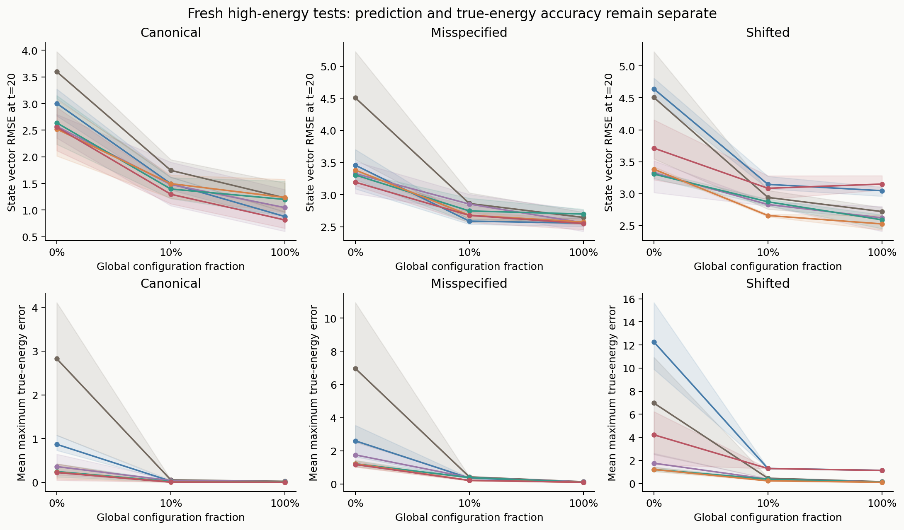
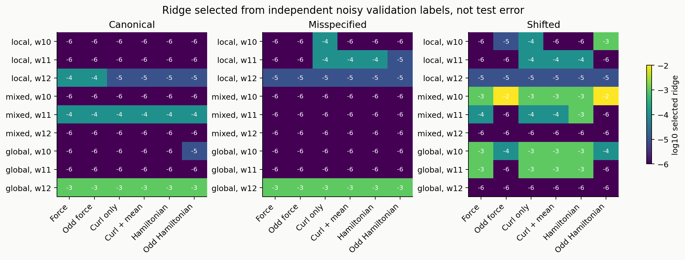
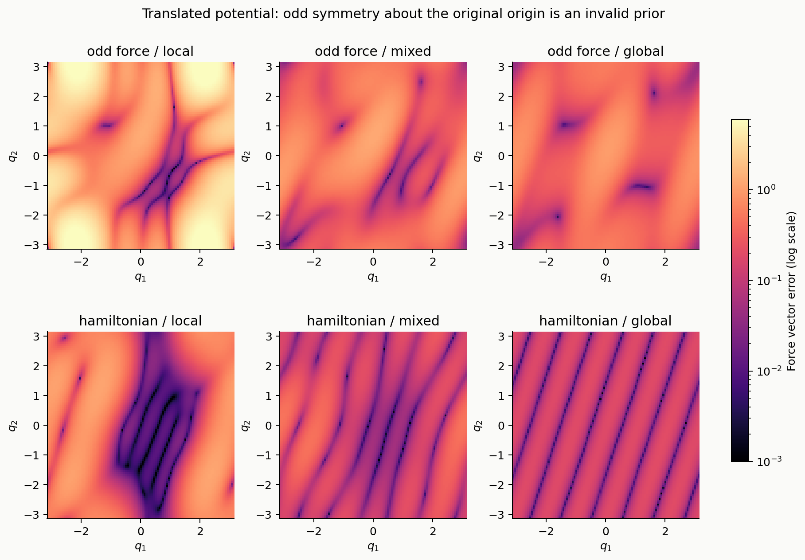
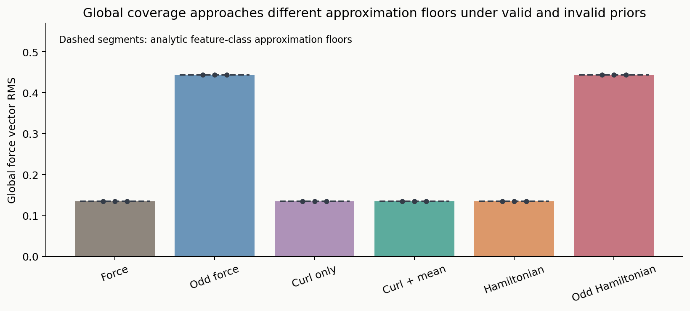
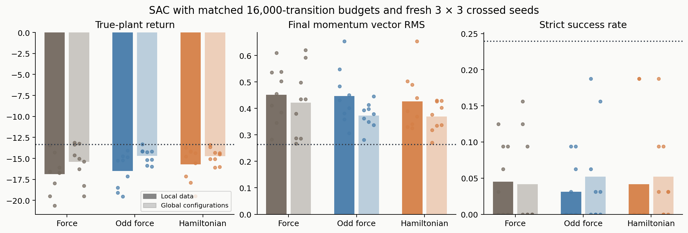
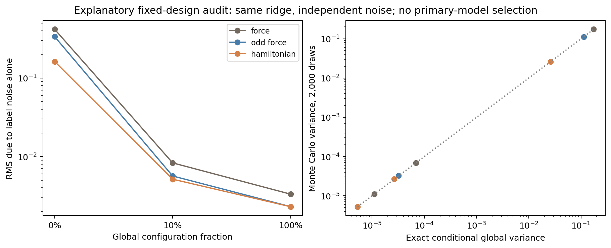

# When structure helps: coverage, coordinate priors and control optimization in Hamiltonian world models

**Phase 6 working manuscript.** A controlled Fourier-feature benchmark, not a general deep-HNN comparison or a submission-level originality claim.

## Abstract

We investigate when Hamiltonian structure improves prediction and control after separating representation, mechanical priors, data coverage and optimization. Six force-model families share a periodic feature bandwidth and known kinetic and torque-port structure. A fixed sample-budget intervention replaces local low-energy observations with global configuration observations at fractions zero, approximately ten percent and one hundred percent. Each of 162 models is selected from a frozen candidate grid using only independent noisy validation labels; fresh energy-stratified initial states supply prediction and control tests. Fixed feedback and projected-gradient MPC are evaluated in 220 configurations, and 57 new crossed-seed SAC runs compare coverage endpoints. Under local observations, Hamiltonian constraints reduce global force error and estimation-noise amplification relative to unconstrained force and a same-dimension odd-force baseline. Broad coverage largely removes the force-model ranking in the deliberately misspecified plant. A coordinate-origin probe reveals an approximation floor caused by incorrect parity. Strong controllers convert improved model coverage into accurate tracking, whereas finite-budget SAC retains substantial optimization error. Exact fixed-design regression variance and Fourier approximation floors explain these mechanisms without establishing a new learning method or a universal RL advantage.

## 1. Question and study design

The core question remains: **when does Hamiltonian structure improve cross-energy prediction and control after accounting for representation, mechanical priors, coverage and optimization?** Phase 5 demonstrated that energy conservation, true-force accuracy and finite-budget SAC performance are distinct. This stage changes the evidence in four ways:

1. Primary hyperparameters are selected by a validation-only rule, rather than a single fixed ridge or posthoc test ranking.
2. Coverage changes at fixed training and validation counts.
3. An odd-force model provides a non-Hamiltonian baseline with the same coefficient dimension as the Hamiltonian model.
4. Fixed feedback and MPC test control transfer separately from SAC training.

All primary choices are recorded in `phase6_protocol.json` before fitting or evaluation. One subsequent fixed-design noise audit is explicitly explanatory and posthoc. It never alters a primary model or policy.

## 2. Plants, representation and priors

The canonical potential is

\[
V_0(q)=1-\cos q_1+0.8(1-\cos q_2)+0.3[1-\cos(q_1-q_2)].
\]

The misspecified plant adds \(0.06[1-\cos(3q_1-q_2)]\). The shifted condition translates this second potential by \(s=(0.45,-0.35)\), using \(V_s(q)=V(q-s)\). All conditions have

\[
H(q,p)=\tfrac12\|p\|^2+V(q),\qquad \dot q=p,\qquad \dot p=-\nabla V(q)+u.
\]

The shifted condition is a **coordinate-origin probe**, not a third independent physical-system replication. Its force is odd about the translated symmetry center, but generally not about the original origin. Recentring at the correct center could restore that parity; no learned-centering baseline is evaluated here.

Each family uses 12 Fourier frequency representatives of maximum coordinate frequency two, yielding 25 scalar spatial features. The added frequency (3,-1) is omitted from every fitted family. Model classes are:

| Family | Constraint or prior | Free coefficients |
|---|---|---:|
| Force | General periodic force | 50 |
| Odd force | Sine-only force, odd about the origin | 24 |
| Curl only | Soft population curl penalty | 50 |
| Curl + mean | Soft curl and mean-force penalties | 50 |
| Hamiltonian | Exact periodic potential gradient | 24 |
| Odd Hamiltonian | Gradient of an even periodic potential | 12 |

Coefficient count does not fully characterize effective capacity: soft penalties also shrink statistical degrees of freedom. These are fixed-feature heads with convex objectives, not trainable-feature neural networks. All families know unit kinetic energy, qdot=p and unit torque ports. Force labels are noisy derivative measurements, not finite-difference estimates from observed trajectories.

## 3. Fixed budgets and validation-only selection

For each of three fresh world seeds (10,11,12) and each plant condition, independent local/global training pools and independent local/global validation pools are generated. Local snapshots lie in true energy [0.2,1.2]; global configurations are uniform on the torus with momentum zero. Local positions are sampled by rejection from a bounded uniform phase-space proposal. Neither this sampling nor the test sampling is uniform in energy.

Each coverage condition uses 4,096 training labels and 1,024 validation labels. The approximately ten-percent condition contains 410 global training configurations and 102 global validation configurations, with local prefixes filling the remaining budgets. Labels are shared when pool points are reused across coverage conditions. Force noise is independent Gaussian with standard deviation 0.03 per component. Across the three plant conditions and three world seeds, the underlying pools contain **73,728 plant-conditioned training force labels** and **18,432 validation force labels**. Summing the nominal budgets of all coverage conditions would double count reused observations.

Changing configuration coverage also changes the distribution and energy of observations. Global zero-momentum samples expose high-potential configurations but not high momentum. Because momentum dependence is known analytically, this experiment isolates configuration coverage; it does not learn general momentum-dependent Hamiltonians. The sampling intervention assumes a synthetic force-query oracle and does not include the physical cost of reaching configurations on a robot.

The ridge grid is 1e-6, 1e-5, 1e-4, 1e-3 and 1e-2. Soft structural strengths are 0.01, 0.1, 1 and 10. Each family and coverage condition minimizes its independent noisy-validation vector MSE, using a fixed candidate order for ties. Training does not incorporate validation labels, and models are not refitted after selection. This produces **1,620 candidate fits and 162 selected models**. No true global-force score, long-rollout test or control outcome selects these models.

Fresh test initial states use energy bands [1.3,2.0], [2.2,3.2] and [4.4,6.0], with 32 states per band. The high-energy band is labelled `rotation` operationally; it does not assert a single separatrix threshold or pure rotation for every coupled-system initial state. Tests are paired across model and coverage conditions. Three world seeds give descriptive variability rather than population-level significance.

## 4. Force estimation and cross-energy prediction

Global force RMS is the square root of the mean squared vector norm on a uniform 128-by-128 torus grid. The following means average three world seeds.

| Plant | Family | Local data | Approximately 10% global | Global configurations |
|---|---|---:|---:|---:|
| Canonical | Force | 0.3442 | 0.0081 | 0.0032 |
| Canonical | Odd force | 0.2655 | 0.0061 | 0.0019 |
| Canonical | Hamiltonian | 0.1167 | 0.0043 | 0.0024 |
| Misspecified | Force | 0.8383 | 0.1853 | 0.1345 |
| Misspecified | Odd force | 0.8004 | 0.1824 | 0.1344 |
| Misspecified | Hamiltonian | 0.6042 | 0.1803 | 0.1343 |
| Shifted | Force | 0.8383 | 0.1891 | 0.1346 |
| Shifted | Odd force | 2.5477 | 0.5023 | 0.4438 |
| Shifted | Hamiltonian | 0.6042 | 0.1817 | 0.1344 |

Valid Hamiltonian restrictions help under local coverage in these cases, including against the same-dimension odd-force baseline. That benefit becomes much smaller when coverage improves. With full configuration coverage in the misspecified plant, all unconstrained, soft-constrained and exact-Hamiltonian families approach the same missing-mode floor near 0.1342. The fixed sample count and the very large improvement at ten percent coverage show that sample location, not only sample count, is consequential.

Force improvement does not remove long-horizon error. In the misspecified plant, Hamiltonian high-energy state-vector RMSE at time 20 decreases from 3.3827 with local data to 2.6804 with mixed data and 2.5748 with global configurations. The globally trained force and odd-force models have values 2.6463 and 2.5572. Thus accurate forces up to the missing-mode floor do not establish a uniform long-rollout ranking. State error combines wrapped angle error and momentum error in nondimensional coordinates, not a unit-invariant physical distance.

**Figure 1.** Three-seed means and ranges, not confidence intervals. Coverage levels are discrete experimental conditions. Dotted reference lines show analytic approximation floors in misspecified cases.

**Figure 2.** High-energy unforced prediction and maximum true-energy error along fitted trajectories. Structural conservation and true energy-landscape accuracy remain separate.

**Figure 3.** Each displayed exponent is a ridge selected from noisy validation labels. Soft penalty choices are recorded in the selection CSV and JSON. Different conditions need not select the same ridge; this intervention studies the frozen selection rule as well as the model classes.

## 5. The coordinate-origin probe and approximation floors

For a periodic potential force, translating the origin rotates each frequency's sine/cosine coefficient pair. General Fourier force and Hamiltonian classes are closed under this rotation. Sine-only classes are not. On paired local data, the equivariant fits for full force, curl/mean and Hamiltonian models are independently checked to agree after translating their arguments.

Fourier orthogonality gives a common full-feature force RMS floor

\[
\frac{0.06\sqrt{3^2+(-1)^2}}{\sqrt2}=0.06\sqrt5\approx0.1341641.
\]

An odd model in the shifted condition must additionally discard the included cosine components. Its squared floor is

\[
5(0.06)^2+\tfrac12\sum_{j\in\{1,2,d\}}a_j^2\|k_j\|^2\sin^2(k_j\cdot s),
\]

which yields approximately 0.4435. Both odd-force and odd-Hamiltonian fits approach that larger floor with global coverage. More data cannot eliminate an approximation error caused by an incorrect fixed-origin prior. This is a classical projection fact and a deliberate stress test, not evidence that correctly centered odd methods fail.

**Figure 4.** World seed 10 in the translated condition; common logarithmic color scale. Exact Hamiltonian structure does not require origin-centered parity. The color scale displays errors from 0.001 to 6; full numerical values remain in saved results.

**Figure 5.** Three globally fitted seed values and analytic feature-class floors. The shifted odd models remain Hamiltonian when applicable, yet have the wrong additional parity restriction.

## 6. Stronger controller tests

All selected models in the misspecified and shifted conditions are evaluated with two controllers: fixed gain-2 force-cancelling feedback and deterministic projected-gradient MPC. There are 216 learned-model configurations and four unique privileged references, totaling **220 controller evaluations** on 32 paired high-energy initial states. These controllers require no policy training; they observe the state and query their fitted force at control/planning states.

The fixed feedback law is

\[
u=\operatorname{clip}[-F_{\rm model}(q)-2(p-p^*),-2,2],\quad p^*=(2.5,1.5).
\]

MPC uses a 12-step, 0.6-time-unit kick-drift symplectic-Euler planning horizon. Its cost integrates momentum tracking and action effort with a terminal momentum penalty. Initialization chooses between a shifted previous plan and a feedback rollout under the same model. Six projected-gradient iterations with per-trajectory backtracking accept only a nonincreasing model-surrogate cost. The true plant uses RK4 with five 0.01 substeps per control interval. All controller settings are frozen before outcomes. Surrogate descent does not prove global optimality, closed-loop stability or true-cost descent.

Mean final momentum vector RMS in the unshifted misspecified plant is:

| Family / controller | Local data | Approximately 10% global | Global configurations |
|---|---:|---:|---:|
| Force / feedback | 0.2671 | 0.0392 | 0.0270 |
| Hamiltonian / feedback | 0.1714 | 0.0359 | 0.0269 |
| Force / MPC | 0.1810 | 0.0328 | 0.0240 |
| Hamiltonian / MPC | 0.1258 | 0.0304 | 0.0239 |

Hamiltonian restrictions help these controllers more under local coverage; coverage largely eliminates that distinction. On the globally covered unshifted plant, all six model families achieve 100% strict success under both feedback and MPC. In the shifted plant, global odd-force MPC has mean tracking RMS 0.1156, compared with 0.0238 for the Hamiltonian model, reflecting the incorrect-origin prior.

Known-force feedback and true-model MPC references achieve RMS 0.0169 and 0.0080, respectively, with 100% success. They query privileged true force, including at planning states, and are **not** fair learning-budget baselines or theoretical upper bounds. All evaluations retain full true trajectories; no test speed clipping or reset occurs. The largest true momentum magnitude among these controller tests is 3.815.

**Figure 6.** Means and ranges across three world seeds. The dotted privileged reference uses a different information-access condition. The shifted condition is the same physical potential translated in configuration coordinates.

## 7. Matched SAC coverage runs

Three families—force, odd force and Hamiltonian—are evaluated at the local/global coverage endpoints on the unshifted misspecified plant. Three world seeds crossed with three policy seeds yield 54 learned-model runs; three unique true-only references produce **57 actual SAC runs**. No shifted-system SAC or mixed-coverage SAC is claimed.

Each run collects 16,000 transitions and performs 7,492 updates with the Phase 5 architecture and settings: eight lanes, 1,024 warmup transitions, two 64-unit hidden layers, alpha 0.01, discount 0.99, learning rate 3e-4 and batch 256. Reset states are independent of test states and shared across families/coverage. Every checkpoint is final, with no test selection. Learned-model policy training uses no additional true transitions. The world-model training and validation labels remain part of its truth-data budget.

Total policy collection is 912,000 transitions: **864,000 model transitions and 48,000 true transitions**. Force snapshots and validation labels are separate data units. Evaluations supply no training updates.

| Training dynamics | Local momentum RMS | Global-config momentum RMS | Local strict success | Global-config strict success |
|---|---:|---:|---:|---:|
| Force | 0.4522 | 0.4223 | 4.5% | 4.2% |
| Odd force | 0.4463 | 0.3734 | 3.1% | 5.2% |
| Hamiltonian | 0.4270 | 0.3697 | 4.2% | 5.2% |

The true-only reference averages RMS 0.2640 and strict success 24.0%. Improved model coverage helps the mean continuous SAC metric, especially for the odd and Hamiltonian families, but does not produce the reliable tracking achieved by feedback/MPC with the same models. Global-data Hamiltonian and odd-force SAC are nearly tied. No general HNN superiority follows.

The common training guard resets nonfinite states or momentum exceeding ten and retains finite exit transitions in replay. There are **36 speed-related resets across 12 runs**, including one in a true-only reference, and **zero nonfinite training transitions**. Counts are: local force 15, global force 4, local odd force 8, global odd force 0, local Hamiltonian 4, global Hamiltonian 4, true-only 1. These resets are preserved. Model-induced resets can change replay and later reset-state streams, so paired initial weights and nominal budgets do not imply identical training distributions.

Averages use nine crossed cells on the same 32 test states, while true-only uses three runs. Cells sharing a world or policy seed are dependent; descriptive seed ranges and all cells are retained rather than IID-cell significance tests. The fixed SAC settings are intentionally held constant and are not certified optimal for this task.

**Figure 7.** Individual crossed-seed outcomes and mean bars. Dark/light bars represent local/global configuration data. Dotted lines represent three unique true-only runs, not repeated aliases.

## 8. Fixed-design noise audit

A separate diagnostic protocol, frozen after primary prediction outcomes, fixes world seed 10, ridge 1e-6 and the misspecified plant. For each of three coverage conditions and three families, it computes exact conditional global force-estimation variance and checks it with 2,000 independent Gaussian sufficient-statistic perturbations. These 18,000 noise draws are neither additional primary fits nor new state coverage or policy training.

For a force subspace v=T theta, empirical design D_T, population force metric R_T and fixed regularized Hessian A_T, standard linear regression gives

\[
\mathcal V=\frac{\sigma^2}{N}\operatorname{tr}(R_T A_T^{-1}D_T A_T^{-1}).
\]

Without additional soft penalties, whitening the force metric yields

\[
\mathcal V=\frac{\sigma^2}{N}\sum_j\frac{d_j}{(d_j+\lambda)^2},
\]

where d_j are normalized design eigenvalues. This explains how local coverage can amplify noise, and why a valid gradient subspace can have a better restricted design spectrum than a same-dimension odd-force space.

The resulting RMS due to label noise alone is:

| Family | Local design | Approximately 10% global | Global design |
|---|---:|---:|---:|
| Force | 0.4167 | 0.00831 | 0.00332 |
| Odd force | 0.3358 | 0.00566 | 0.00230 |
| Hamiltonian | 0.1622 | 0.00515 | 0.00230 |

The smallest normalized full-force design eigenvalue rises from about 1.30e-7 under local observations to 0.0753 under mixed coverage and 0.870 under global coverage. Monte Carlo variance agrees with the exact expression within 1.35% in every audited case.

This calculation isolates variance. It omits approximation, regularization and extrapolation biases. Its ridge is fixed independently for this explanatory audit; it does not supply the unconditional risk of validation-selected models. The formulas are standard regression identities, not new generalization theorems or RL guarantees.

**Figure 8.** Exact fixed-design RMS and independent Monte Carlo covariance checks. Primary model choices and policy checkpoints are unchanged.

## 9. Numerical checks and simulations

Analytic true-force Jacobians agree with central finite differences to at most 1.15e-10. NumPy RK4 controlled endpoints agree with independent DOP853 solutions to at most 4.45e-10 over one time unit. Fitted-force Jacobians agree to below 8e-11; Torch/NumPy one-interval discrepancies are below 3.81e-7. MPC discrete adjoints agree with finite differences to below 2.43e-10, and no saved controller step increases its initialization surrogate cost. This is numerical validation, not a stability proof.

The final verifier checks all model-selection minima, pool counts, disjoint training/validation points, energy bands, approximation floors, translated local-model equivariance, controller grids, SAC grids, fingerprints, budgets, reset records and animation frames. Runtime versions are retained in `runtime.json`.

Two animations use actual saved trajectories: `coverage_prediction.gif` compares local and mixed-coverage force/Hamiltonian predictions; `coverage_control.gif` compares local/global Hamiltonian models under SAC, feedback and MPC in the same true plant. World seed 10, policy seed 10 and high-energy initial state index 0 are fixed before outcome-based comparisons. Each animation has 101 frames and plays at twice simulation speed. Parallel rods encode the angular coordinates with a schematic coupling line, not a serial double pendulum or a literal Cartesian spring.

## 10. Related work, originality and next stage

Hamiltonian feature/kernel learning with odd symmetry is established in Smith and Egeland [1,2]. Convex fitting, sine-only parity restrictions, validation selection and basic MPC are consequently baselines, not new methods. Model-based policy optimization [3] already treats model error and policy distribution as consequential; its full algorithm is not reproduced by our model-only SAC protocol. Decision-aware model learning [4] also predates the project.

This stage provides a reproducible empirical benchmark and an applied mathematical explanation of several confounds. It narrows an answer to the core question: in this feature class, valid Hamiltonian structure helps force estimation and strong-controller transfer most under limited configuration coverage; broad coverage and invalid additional priors change that benefit; SAC optimization can obscure it. This is not a claim about all Hamiltonian neural networks, all coupled systems or real robotic data.

An original academic paper still needs either a distinct control-relevant method/theory or a sufficiently broad and well-positioned empirical contribution. The next stage should investigate task-relevant acquisition or model fitting under a fixed measurement budget, with classical optimal-design, random-coverage and uncertainty-based baselines. Its nearest-method review must precede novelty claims. Trainable-feature models, correctly recentered parity methods and genuinely independent physical systems remain important tests. The fixed-design risk expression itself must not be presented as that originality.

## References

[1] Smith, T., and Egeland, O. *Learning Hamiltonian Dynamics with Reproducing Kernel Hilbert Spaces and Random Features*. European Journal of Control, 2024. https://arxiv.org/abs/2404.07703 (primary abstract reviewed)

[2] Smith, T., and Egeland, O. *Learning dissipative Hamiltonian dynamics with reproducing kernel Hilbert spaces and random Fourier features*. 2024 preprint / IFAC-PapersOnLine. https://arxiv.org/html/2410.18656v1 (feature-regression and structural-method sections reviewed)

[3] Janner, M., Fu, J., Zhang, M., and Levine, S. *When to Trust Your Model: Model-Based Policy Optimization*. 2019. https://arxiv.org/abs/1906.08253 (primary abstract reviewed; no claim of full-method replication)

[4] Farahmand, A.-M., Barreto, A., and Nikovsky, D. *Value-Aware Loss Function for Model-based Reinforcement Learning*. AISTATS 2017. https://proceedings.mlr.press/v54/farahmand17a.html (prior-stage primary abstract review)
