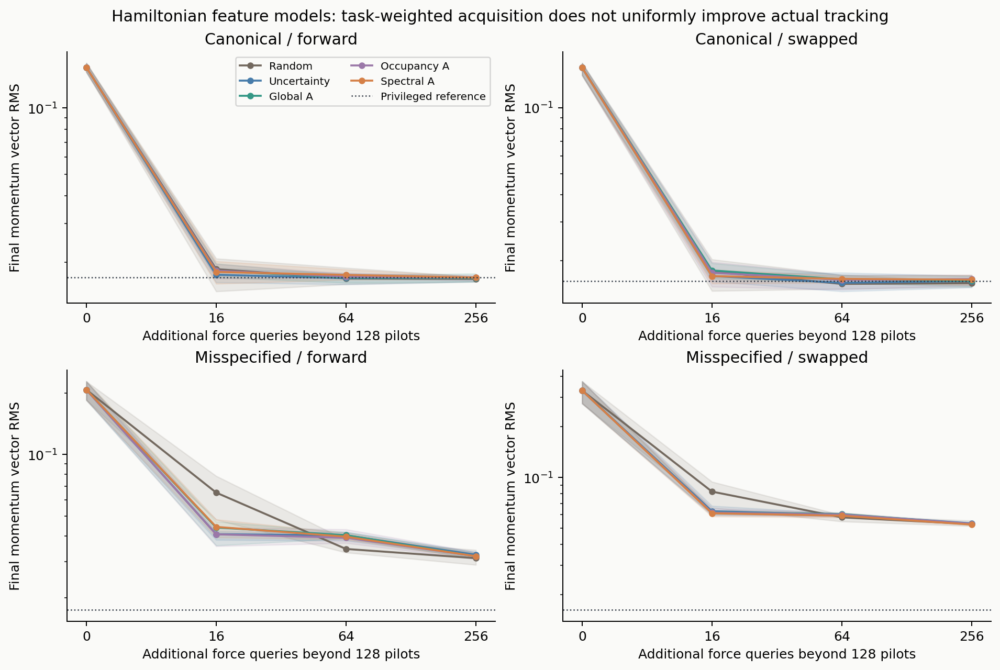
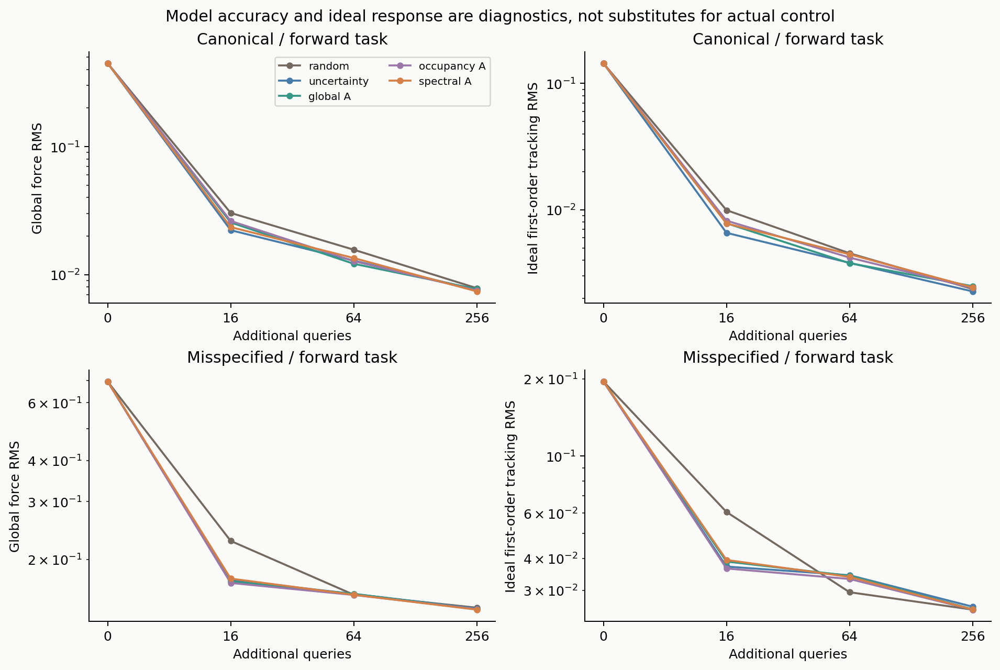
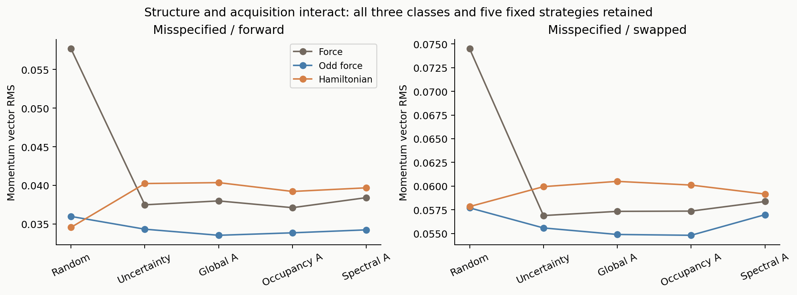
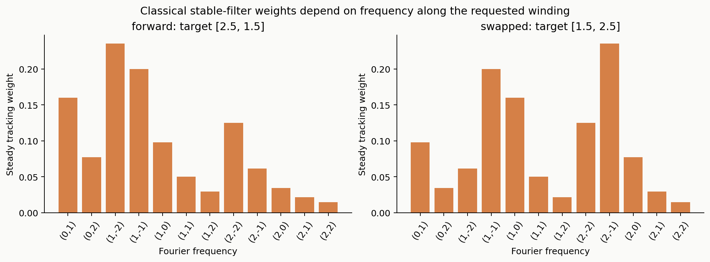
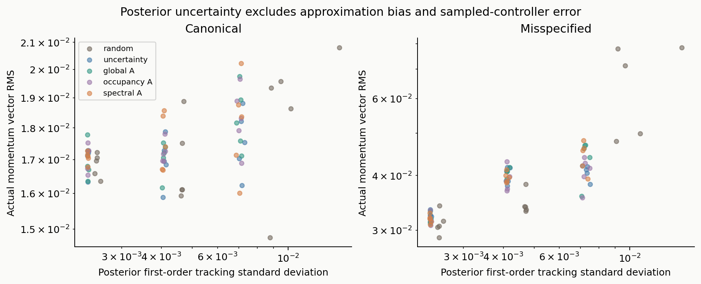

# Phase 7: Task-weighted acquisition under a fixed force-query budget

## Abstract

We test whether a control-relevant experimental-design criterion improves Hamiltonian world-model control beyond random coverage and classical uncertainty/design baselines. Two coupled-pendulum plants, three linear force families, five acquisition criteria and five paired world seeds are evaluated under a frozen protocol. The spectral task-weighted candidate fails all four primary plant/task screening cells. At 64 additional measurements, its mean tracking error exceeds the best baseline by 3.8%, 5.5%, 14.8% and 2.3%. The algorithmic principle is already covered by task-optimal experimental design. This stage therefore stops the new-algorithm route and preserves an auditable comparative result. It does not establish an original method or a general reinforcement-learning advantage.

## 1. Research question and positioning

The project asks: **when does Hamiltonian structure improve cross-energy prediction and control after accounting for coordinate representations, mechanical priors, coverage, regularization and optimization?** Phase 7 isolates acquisition after Phases 1–6 separated several of these factors. Its narrower question is whether first-order tracking relevance supplies a useful acquisition advantage after matching representation and measurement budget.

The nearest-method review is in [novelty_review.md](novelty_review.md). Task-optimal linear and nonlinear exploration already use task-dependent information criteria; Bayesian active RL and transition-occupancy matching address richer policy-sensitive objectives. Our criteria are transparent specializations, not replications of those algorithms. Generic weighted A-optimality is not an original contribution. The mathematical calculations below specialize classical filtering, Gaussian regression and invariant design.

## 2. Models and acquisition protocol

Both plants have known unit mass, known torque ports and known kinematics, with configuration on the two-dimensional torus. One plant lies in the fitted Fourier class; the other adds the omitted potential harmonic `0.06[1-cos(3q1-q2)]`. These are two conditions of the same mechanical family, not independent physical benchmarks.

We compare unrestricted force heads (50 coefficients), sine-only odd-force heads (24) and Hamiltonian gradient-force heads (24). These are fitted linear Fourier heads, not a comparison of general deep neural architectures. Each plant/world-seed pair starts with 128 low-energy noisy force pairs, energy in [0.2,1.2], noise standard deviation 0.03. A pool of 1,024 unlabelled uniform torus configurations is available. Added budgets are 0, 16, 64 and 256, sampled without replacement. Force is evaluated only at selected pool indices. Generative configuration queries are assumed free of reachability cost.

The Gaussian head uses population force-whitened coefficients and scalar prior precision `rho=0.05`. With feature block B(q), precision A and noise variance sigma²,

\[
 A=\rho I+\sum_i B(q_i)^\top B(q_i),\qquad
 \widehat\beta=A^{-1}\sum_i B(q_i)^\top y_i,\qquad
 \Sigma=\sigma^2 A^{-1}.
\]

This is posterior covariance under the stated prior; it excludes approximation bias. There is no validation-query budget or posthoc hyperparameter selection.

| Criterion | Acquisition objective |
|---|---|
| random | Uniform pool selection |
| uncertainty | Maximum posterior force variance at the candidate |
| global_A | Minimum integrated posterior force variance |
| occupancy_A | Weighted covariance trace under a frozen prescribed-motion occupancy |
| spectral_A | Weighted covariance trace using first-order tracking frequency weights |

The task-dependent weights use target momenta (2.5,1.5) and (1.5,2.5), feedback gain 2 and nominal motion q(t)=q0+p*t. Occupancy paths are prescribed motion, not true closed-loop trajectories. Labels do not affect selection: only geometry, prior covariance, task and previous selected locations do. Stateless paired noise is shared whenever methods request the same label.

There are 210 acquisition paths, 30 pilot fits and 630 incremental checkpoints: **660 unique fitted models**. The 840 acquisition records contain pilot aliases. Across paths there are 53,760 added-query calls, but only 8,001 distinct plant/world/pool-index label keys, plus 1,280 unique pilot labels. Every individual path uses exactly 128+B labels. Cross-run reuse does not reduce that per-path budget.

## 3. True-plant control evaluation

We freeze the controller

\[
 u=\operatorname{clip}\{-\widehat F(q)-2(p-p_*),-2,2\}.
\]

True dynamics are integrated using RK4 with five 0.01 substeps per held-control interval of 0.05, over 20 time units. Each model/task uses 64 fresh uniform configuration phases with initial momentum exactly p*. Initial energy is at least 4.25, outside the pilot energy band. This tests holding/tracking after global configuration acquisition, not swing-up, arbitrary momentum dependence or unknown mass transfer.

The primary metric is momentum-vector RMS over the final 100 states (five time units), averaged over the 64 phases. Strict success requires error norm below 0.25 throughout that window. There are 960 distinct learned-model/task evaluations and four privileged known-force references: **964 actual evaluations**. The 1,200 reported rows include equal pilot aliases. All outputs are finite. The known-force reference is privileged, not a theoretical upper bound: sampled torque holding can interact with model error.

No new SAC training was authorized by the frozen Phase 7 protocol. Actual SAC results from Phases 3–6 remain the RL optimization anchor. The primary screen concerns a fixed controller, so it cannot establish an RL return advantage.

## 4. Frozen gate and results

The primary gate uses the Hamiltonian family at B=64. In every one of four plant/task cells, spectral_A must improve mean RMS by at least 10% over the best of the four baselines and win at least four of five paired world seeds. At B=16 and B=256 it must not degrade by more than 10% against the best baseline. This is a practical descriptive screen, not a significance test. The 64 phases are not 64 independent training-seed replications.

| Plant | Target | Best baseline RMS | Candidate RMS | Candidate degradation | Paired seed wins | Gate |
|---|---|---:|---:|---:|---:|---|
| canonical | forward | 0.016906 | 0.017547 | 3.79% | 2/5 | fail |
| canonical | swapped | 0.015687 | 0.016543 | 5.46% | 1/5 | fail |
| misspecified | forward | 0.034552 | 0.039674 | 14.83% | 0/5 | fail |
| misspecified | swapped | 0.057841 | 0.059162 | 2.28% | 2/5 | fail |

Random is the best mean baseline in all four cells; this was determined by comparison with all baselines, not chosen in advance as the sole comparator. Other-budget degradations remain below 10%, but cannot compensate for the primary failures. See `decision.json` for unrounded results.

*Figure 1. Hamiltonian-family tracking versus additional query budget. Methods share pilot labels and paired measurement noise.*

*Figure 2. Primary B=64 outcomes retain each world seed, avoiding an apparent large replication count from within-model phases.*

*Figure 3. Force prediction and ideal first-order tracking diagnostics. Neither is the actual held-action nonlinear controller objective.*

*Figure 4. All three fitted force families under the same measurement budget. Representation effects and acquisition effects are distinct.*

*Figure 5. Task-dependent frequency weights; changing target momentum changes temporal frequencies of spatial harmonics.*

*Figure 6. Posterior tracking uncertainty and actual tracking error. The covariance excludes omitted-mode bias and controller discretization effects.*

For example, on the misspecified forward task at B=64, random and spectral_A have posterior tracking standard deviations 0.00470 and 0.00411, while ideal response errors are 0.02950 and 0.03384 and actual tracking RMS values are 0.03455 and 0.03967. Reducing the stated covariance criterion therefore does not demonstrate improved control. Bias, location-dependent fitting and torque holding are plausible explanations; this experiment does not causally isolate each mechanism.

## 5. Mathematical interpretation

[mathematical_note.md](mathematical_note.md) derives the first-order response, rank-two covariance update and their assumptions. For an unsaturated continuous controller and small force perturbation, the linear response obeys

\[
 \dot\eta+\kappa\eta=\delta F(q_0+p_*t).
\]

Uniform initial phases give a Fourier contribution proportional to `1/[kappa²+(k·p*)²]`. This yields the candidate weights, but is a fixed-time first-order calculation, not a nonlinear stability or optimal-return theorem. The omitted harmonic contributes ideal first-order RMS values 0.02121 and 0.04743 on the two tasks; these are not exact nonlinear lower bounds.

A explicitly posthoc invariant-design calculation shows that, for a translation-closed force space, translation-invariant spectral metric, scalar prior and **no fixed nonuniform pilot information**, Haar-uniform approximate design minimizes the convex weighted inverse-information trace. This specializes classical invariant optimal design. The actual local pilot violates that idealization; finite pool selection and the sine-only space also require separate treatment. The lemma does not prove our observed negative result inevitable, nor rescue a novelty claim.

Numerical checks reproduce covariance gains to 3.15e-14, Parseval calculations to 8.9e-16 and response ODE residuals below 4.38e-9. A small-perturbation check halves normalized response error when perturbation magnitude halves. The independent symmetry check has maximum Haar-identity error 5.44e-15. These validate calculations within their scope.

## 6. Dynamic visualizations

*Acquisition animation: five actual methods, one frozen misspecified/Hamiltonian/forward seed. Frame index is query count, not physical time. Heatmaps show posterior force variance and exclude bias; all panels use a common scale.*

*Control animation: true RK4 trajectories for a fixed held-out phase, comparing random, global_A and spectral_A at B=16 and B=64. Parallel rods illustrate the angular coordinates and coupling; the trajectories and tracking traces are actual simulation outputs. Playback is twice physical speed. A single selected trajectory is illustrative, not the aggregate test.*

## 7. Verification and decision

`verify_phase7_results.py` independently checks all queried labels, pool uniqueness, direct normal-equation fits, source/protocol fingerprints, pilot aliases, actual evaluation counts, the approximation floor and the unchanged gate. Maximum inverse check error is 1.27e-12 and MAP stationarity residual is 2.62e-9. No unselected pool labels were evaluated during acquisition. Both GIFs are complete (65 and 101 frames).

**Decision: stop the new-algorithm route.** Neither generic algorithmic novelty nor the numerical gate is cleared. Conditional MPC confirmation is not required; no additional tuned acquisition variants or new SAC runs are added. The negative result remains part of the record.

Phase 8 will validate and consolidate a comparative-study contribution against its strongest alternatives, rather than rename a failed candidate as a successful method. Phase 9 will assemble the final academic manuscript, reproducible repository and showcase materials. An original publishable contribution remains unconfirmed. The present evidence supports a careful comparative report; publication or acceptance is not guaranteed.

## Reproducibility and sources

Run the Phase 7 command block in the top-level README. The frozen primary protocol is `../phase7_protocol.json`; decision and verification records are in this directory. Related-work URLs and reviewed portions are recorded in `novelty_review.md`; mathematical assumptions and classical-source attribution are in `mathematical_note.md`. Previous stage reports and unsuccessful pilots remain in the cumulative package.
